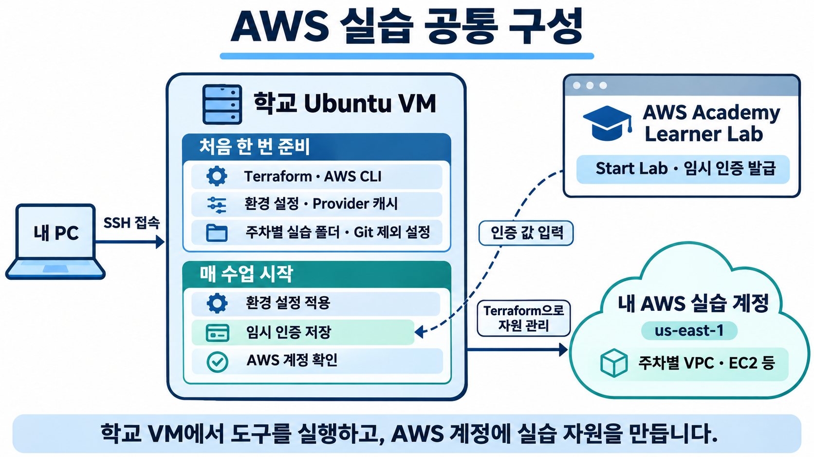

# 클라우드인프라관리

클라우드인프라관리 수업의 주차별 실습 가이드와 학습 자료를 정리하는 저장소입니다.

## 주차별 실습

| 주차 | 주제 | 자료 |
| --- | --- | --- |
| Week 03 | AWS Academy S3: 정적 웹 사이트 호스팅, 버전 관리, 수명 주기, 크로스 리전 복제 | [실습 가이드](week03/README.md) |
| Week 04 | 카페를 위한 AWS VPC 네트워킹 환경 구축 | [실습 가이드](week04/README.md) |
| Week 07 | Terraform으로 VPC 하나 관리하기 | [실습 가이드](week07/README.md) |
| Week 08 | 자원 참조·변수·출력과 EC2 접속 | [실습 가이드](week08/README.md) |
| Week 09 | count·for_each와 State·드리프트 관리 | [실습 가이드](week09/README.md) |
| Week 10 | 모듈 재사용과 dev/test 환경 분리 | [실습 가이드](week10/README.md) |
| Week 11 | Terraform과 Ansible로 웹 서버 구성 | [실습 가이드](week11/README.md) |

실습 절차와 확인할 결과는 각 주차의 README에서 확인할 수 있습니다.

## 7~11주차 실습 준비

먼저 [공통 준비](common/README.md)에서 도구 설치와 AWS 임시 자격 증명 설정을 마칩니다. 학교 Ubuntu를 공통 실행 환경으로 사용하며, 학생마다 자신의 Linux 사용자·홈과 AWS Academy Learner Lab 계정을 사용합니다.

각 교안은 **설명 읽기 → 명령 복사 → 확인할 결과 점검 → 변경 실험 → 자원 정리** 순서입니다. 실행 코드와 설정 파일은 교안의 코드 블록에 포함되어 있으며, 안내된 명령으로 실습 폴더에 작성합니다.

- 도구 설치는 첫 수업 전에 끝내고, 매 수업 시작에는 Lab Ready 상태와 새 임시 인증을 확인합니다.
- 매주 AWS 자원은 삭제하고 코드·State는 보관합니다. Lab Reset이나 State 삭제로 `terraform destroy`를 대신하지 않습니다.
- **count와 for_each 기본 비교는 9주차 A·B부 필수 실습**입니다. 기존 자원의 State 주소 이전은 선택 심화 설계안으로 구분합니다.
- 검증 환경은 Ubuntu 24.04 x86_64, Terraform 1.17.1, AWS Provider 6.71.0, AWS CLI 1.46.2, Ansible Core 2.21.5, us-east-1입니다. 사용 버전과 AMI는 후속 수업 전에 다시 확인합니다.

[검증 리포트](VERIFICATION.md)에서 실제 실행 결과와 미검증 범위를 확인할 수 있습니다.

## 선택 심화 — 필수 수업을 마친 학생만

| 교안 | 실행 시점 | 추가 확인 |
| --- | --- | --- |
| [count→for_each State 이전](extension-state-migration/README.md) | 9주차 A·B부 완료 후 | 교수자용 설계안: moved 블록, AWS 실행 미검증 |
| [Handler와 check/diff](extension-handlers/README.md) | 11주차 26번 후, 정리 전 | 설정 변경 시 reload, 재실행 변경 없음 |
| [내부 ALB](extension-alb/README.md) | 11주차 26번 후, 정리 전 | 두 대상 healthy, EC2에서 내부 HTTP |
| [ASG](extension-asg/README.md) | 11주차 26번 후, 정리 전 | 실제 InService 1대→그룹 인스턴스 0대 |

ALB·ASG는 각 확장 파일의 정리까지 완료한 다음 11주차 정리로 돌아갑니다. 모든 선택 실습을 140분 정규 수업 안에 함께 수행하는 계획은 아닙니다.

Handler는 설정 변경에 따른 서비스 reload와 예측 실행을 추가로 다루는 단계입니다. 내부 ALB는 대상 상태 검사·SG 간 통신·내부 접근 경로를, ASG는 원하는 용량과 실제 용량·새 서버 관리의 경계를 추가로 다룹니다. 11주차 필수 목표인 두 서버의 배포·멱등성·파일 복구를 먼저 마치도록 선택으로 유지합니다. Handler의 --check는 선택이며, 파일 복구 시 사용하는 --diff 자체는 11주차 25번 필수에도 포함됩니다.

## 공식 참고 자료

- [Terraform plan](https://developer.hashicorp.com/terraform/cli/commands/plan)
- [Terraform count](https://developer.hashicorp.com/terraform/language/meta-arguments/count) · [for_each](https://developer.hashicorp.com/terraform/language/meta-arguments/for_each)
- [Terraform 모듈](https://developer.hashicorp.com/terraform/language/modules)
- [Ansible Playbook](https://docs.ansible.com/projects/ansible/latest/playbook_guide/playbooks_intro.html)
