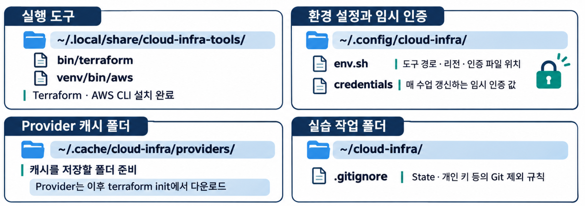

# 공통 준비 — 학교 Ubuntu에서 AWS 실습 시작하기

[전체 실습 목록](../README.md) · [7주차 실습](../week07/README.md)

도구 설치는 처음 한 번, AWS 임시 인증은 매 수업 시작과 토큰 만료 시 수행합니다.



## 0. 학교 VM 접속

PC 터미널에서 접속합니다. `studentNN`과 `vmNN`은 배정받은 값으로 바꿉니다.

```text
ssh "studentNN:vmNN@gate.su-cloud.syu.ac.kr" -p 2222
```

이후 명령은 학교 Ubuntu의 일반 사용자 Bash에서 실행합니다. 처음 접속할 때는 안내받은 서버의 호스트 키인지 확인합니다.

## 1. 처음 한 번 준비

수업 환경은 Ubuntu 24.04, x86_64, Python 3.12입니다. 명령이 실패하면 해결한 뒤 진행합니다.

### 01. 설치 도구 준비

```bash
sudo apt-get update
```

```bash
sudo apt-get install -y curl unzip python3-venv
```

파일 다운로드·압축 해제와 AWS CLI용 Python 가상환경에 필요한 도구입니다.

### 02. 폴더 준비

```bash
mkdir -p "$HOME/.local/share/cloud-infra-tools/bin" \
  "$HOME/.config/cloud-infra" \
  "$HOME/.cache/cloud-infra/providers" \
  "$HOME/cloud-infra"
```

```bash
chmod 700 "$HOME/.config/cloud-infra" "$HOME/cloud-infra"
```

인증·실습 폴더는 본인만 접근하도록 설정합니다.

```bash
cd "$HOME/.local/share/cloud-infra-tools"
```

### 03. Terraform 다운로드와 검증

```bash
curl -fSLO https://releases.hashicorp.com/terraform/1.17.1/terraform_1.17.1_linux_amd64.zip
```

```bash
curl -fSLO https://releases.hashicorp.com/terraform/1.17.1/terraform_1.17.1_SHA256SUMS
```

```bash
grep 'terraform_1.17.1_linux_amd64.zip$' terraform_1.17.1_SHA256SUMS | sha256sum -c -
```

`terraform_1.17.1_linux_amd64.zip: OK`가 나오면 진행합니다.

### 04. Terraform과 AWS CLI 설치

```bash
unzip -oq terraform_1.17.1_linux_amd64.zip -d bin
```

```bash
python3 -m venv venv
```

```bash
venv/bin/python -m pip install 'awscli==1.46.2'
```

AWS CLI는 사용자 가상환경에 설치합니다. `sudo pip`는 사용하지 않습니다.

### 05. 환경 설정 저장

아래 블록을 마지막 `EOF`까지 한 번에 복사합니다.

```bash
cat > "$HOME/.config/cloud-infra/env.sh" <<'EOF'
export PATH="$HOME/.local/share/cloud-infra-tools/bin:$HOME/.local/share/cloud-infra-tools/venv/bin:$PATH"
export AWS_SHARED_CREDENTIALS_FILE="$HOME/.config/cloud-infra/credentials"
export AWS_PROFILE=default
export AWS_DEFAULT_REGION=us-east-1
export AWS_REGION=us-east-1
export AWS_PAGER=""
export TF_PLUGIN_CACHE_DIR="$HOME/.cache/cloud-infra/providers"
unset AWS_ACCESS_KEY_ID AWS_SECRET_ACCESS_KEY AWS_SESSION_TOKEN AWS_SECURITY_TOKEN
EOF
```

수업용 인증 파일과 `us-east-1` 리전을 사용합니다. 마지막 줄은 이전 인증 환경변수를 비웁니다. Provider 캐시는 다운로드를 줄이며, 같은 캐시를 쓰는 `terraform init`은 동시에 실행하지 않습니다.

### 06. Git 제외 파일 저장

State·개인 키·접속 정보가 Git에 올라가지 않도록 설정합니다.

```bash
cat > "$HOME/cloud-infra/.gitignore" <<'EOF'
**/.terraform/
**/*.tfstate
**/*.tfstate.*
**/*.tfplan
**/crash.log
**/*.pem
**/id_ed25519
**/id_ed25519.pub
**/known_hosts
**/inventory.ini
**/connection.auto.tfvars.json
EOF
```

`.terraform.lock.hcl`은 제외하지 않습니다. 이미 Git이 추적 중인 파일에는 제외 규칙이 소급 적용되지 않습니다.

### 07. 설치 확인

```bash
source "$HOME/.config/cloud-infra/env.sh"
```

```bash
terraform version
```

```bash
aws --version
```

Terraform `1.17.1`과 AWS CLI `1.46.2`를 확인합니다.

## 2. 매 수업 시작 및 토큰 만료 시

Learner Lab에서 **Start Lab → Ready → AWS Details → AWS CLI → Show** 순서로 이동합니다. 세 항목의 `=` 오른쪽 값만 복사합니다.

### 08. 임시 인증 저장

아래 블록 전체를 먼저 실행한 뒤, 질문에 맞춰 값을 하나씩 입력합니다. **입력값은 화면에 표시되지 않습니다.** Session Token도 끝까지 복사합니다.

```bash
{
source "$HOME/.config/cloud-infra/env.sh"
read -rsp 'Access Key ID: ' ci_access; printf '\n'
read -rsp 'Secret Access Key: ' ci_secret; printf '\n'
read -rsp 'Session Token: ' ci_token; printf '\n'
if [ -n "$ci_access" ] && [ -n "$ci_secret" ] && [ -n "$ci_token" ]; then
  (umask 077; printf '[default]\naws_access_key_id=%s\naws_secret_access_key=%s\naws_session_token=%s\n' \
    "$ci_access" "$ci_secret" "$ci_token" > "$AWS_SHARED_CREDENTIALS_FILE") &&
  chmod 600 "$AWS_SHARED_CREDENTIALS_FILE" &&
  printf '임시 자격 증명 저장 완료\n'
else
  printf '빈 값이 있습니다. 이 단계를 다시 수행하세요.\n'
fi
unset ci_access ci_secret ci_token
}
```

`임시 자격 증명 저장 완료`를 확인합니다. 인증 값은 과제 화면이나 Git에 포함하지 않습니다.

### 09. 계정 확인

```bash
aws sts get-caller-identity
```

출력의 **Account가 자신의 Learner Lab 콘솔 계정과 같은지** 확인합니다. 오류가 있거나 계정이 다르면 주차별 실습을 시작하지 않습니다.

이후 [주차별 실습](../README.md)으로 이동합니다.

## 명령 실행 방법

- 코드 블록을 위에서 아래로 하나씩 실행합니다. 역슬래시로 이어진 줄과 `cat … <<'EOF'` 블록은 전체를 복사합니다.
- 같은 VM의 같은 Bash를 사용합니다. 새로 접속하면 환경 설정을 `source`하고 계정을 확인합니다. 인증이 만료됐으면 세 값을 갱신합니다.
- 파일 작성 명령은 같은 이름의 파일을 덮어씁니다. 해당 주차 폴더에서 실행합니다.
- `apply 이름.tfplan`은 추가 확인 없이 계획을 적용합니다. 먼저 계획의 생성·변경·삭제 대상을 확인합니다.
- 매주 코드는 남기고 AWS 자원은 정리합니다. 다음 주차는 새 폴더와 State에서 시작합니다.

## 막혔을 때

| 상황 | 확인·조치 |
| --- | --- |
| OS·Python 환경이 의심됨 | `cat /etc/os-release`, `python3 --version`으로 Ubuntu 24.04·Python 3.12 확인 |
| 도구를 찾지 못함 | `source ~/.config/cloud-infra/env.sh` 실행 후 버전 확인 |
| 환경 설정이 적용되지 않음 | `cat ~/.config/cloud-infra/env.sh`로 파일 내용 확인 |
| Git 제외 규칙이 적용되지 않음 | `cat ~/cloud-infra/.gitignore`와 이미 추적 중인 파일인지 확인 |
| `Unable to locate credentials` | 임시 인증 저장 단계를 완료했는지 확인 |
| `ExpiredToken` / `InvalidClientTokenId` | Lab이 Ready인지 확인하고 세 값을 모두 다시 입력 |
| 콘솔과 다른 Account | 작업을 멈추고 올바른 Lab의 인증 값으로 갱신 |
| `AccessDenied` | 서비스·작업·리전을 확인하고 교수자에게 오류 전달 |
| `>` 프롬프트가 계속 나옴 | `Ctrl+C` 후 따옴표와 마지막 `EOF`를 포함한 블록 전체를 다시 입력 |
| 계획에 예상 밖의 삭제·교체가 있음 | `pwd`, 해당 주차 설정 파일과 `terraform state list` 확인 |

토큰이 만료돼도 State를 삭제하지 않습니다. 인증을 갱신한 뒤 같은 폴더에서 계속합니다.

수업 종료 시 주차별 자원 삭제 절차를 완료합니다. EC2 중지만으로는 연결된 저장소 등 모든 자원이 정리되지 않습니다. 자원 정리를 마쳤다면 수업용 인증 파일도 삭제할 수 있습니다.

```bash
rm -f "$AWS_SHARED_CREDENTIALS_FILE"
```

## 참고

- [Terraform 설치](https://developer.hashicorp.com/terraform/install)
- [AWS 임시 자격 증명](https://docs.aws.amazon.com/IAM/latest/UserGuide/id_credentials_temp_use-resources.html)
