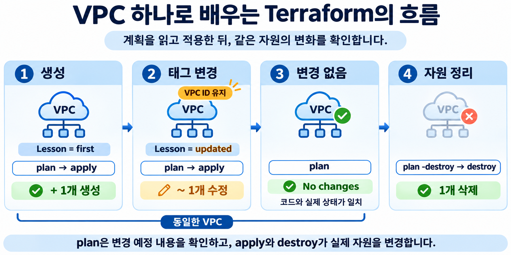
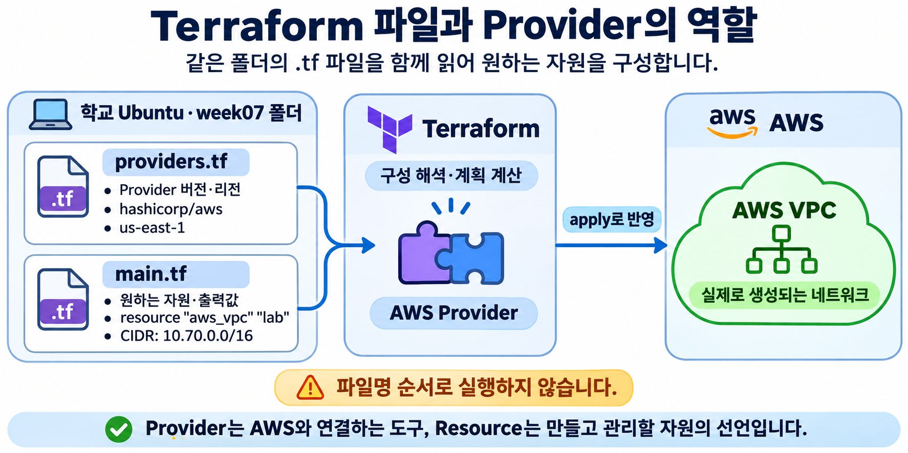
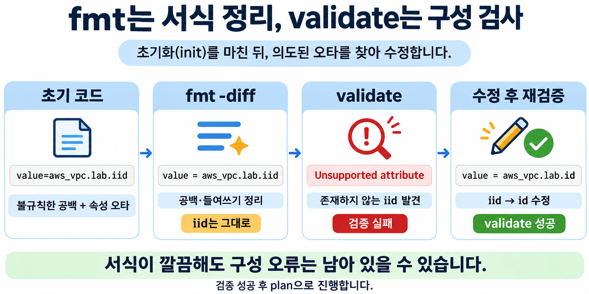
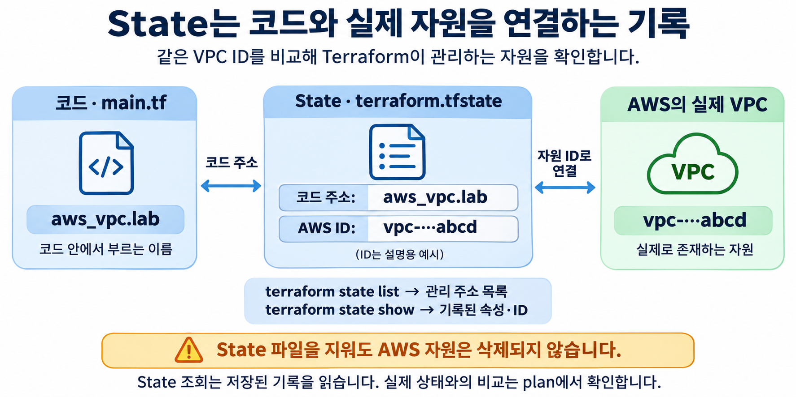

# Week 07 · Terraform으로 VPC 하나 관리하기 실습 가이드

[전체 실습 목록](../README.md) · [공통 준비](../common/README.md)

[← 공통 준비](../common/README.md) · [Week 08 →](../week08/README.md)

이전 IaC 수업에서 배운 선언형 구성을 Terraform으로 실행합니다. **VPC 생성 → 태그 변경 → 변경 없음 → 삭제**를 통해 코드·실제 자원·State가 연결되는 과정을 확인합니다.

## 학습 목표

Provider와 Resource를 구분하고, `fmt`로 서식을 정리한 뒤 `validate`로 구성 오류를 찾아 수정합니다. 계획을 읽은 뒤 적용하며, 태그 변경이 VPC 교체 없이 이루어지는지 확인합니다. 140분 수업: 이론 50분 · 실습 75분 · 정리 15분. 도구 설치는 수업 전에 완료합니다.



## 실습 준비와 설정값

| 항목 | 설정값 |
| --- | --- |
| 실행 환경 | 학교 Ubuntu 24.04 · 일반 사용자 Bash |
| AWS 환경 | 본인의 AWS Academy Learner Lab |
| 리전 | 미국 동부(버지니아 북부) `us-east-1` |
| 수업 시간 | 140분 · 도구 설치는 사전에 완료 |
| 작업 폴더 | `~/cloud-infra/week07` |

[공통 준비](../common/README.md)의 도구 설치·인증을 완료합니다. 이전 주차 AWS 자원은 삭제하고 코드와 State는 보관합니다. 이번 주차 폴더에 이미 실습 파일이나 자원이 있다면 먼저 기존 실습의 정리 단계를 마칩니다.

**실행 위치는 별도 표시가 없는 한 학교 Ubuntu 일반 사용자입니다.** 아래 블록을 번호 순서대로 전체 복사합니다. EC2 안에 대화형으로 들어가서 다음 Terraform 명령을 실행하지 않도록 주의합니다.

## 실습 절차

### 01. (학교 Ubuntu · 일반 사용자) 환경 불러오기와 주차 폴더 준비

```bash
source "$HOME/.config/cloud-infra/env.sh"
aws sts get-caller-identity
mkdir -p "$HOME/cloud-infra/week07"
cd "$HOME/cloud-infra/week07"
pwd
```

**명령어 풀이**

- `source`로 도구 경로·전용 인증 파일·리전을 설정합니다.
- `Account`가 자신의 Learner Lab 콘솔 계정과 같은지 확인한 뒤 진행합니다.
- 이 주차 폴더에 `.tf` 코드와 State가 함께 저장됩니다. `sudo terraform`은 사용하지 않습니다.

**확인할 결과**

현재 경로가 `/home/자신의계정/cloud-infra/week07`입니다.

### 02. (학교 Ubuntu · 일반 사용자) providers.tf 작성



아래 코드는 `fmt`의 효과를 확인하도록 들여쓰기와 등호 주변 공백을 일부러 불규칙하게 작성했습니다. **지금은 직접 정렬하지 말고 그대로 복사합니다.**

```bash
cat > providers.tf <<'EOF'
terraform {
required_version="= 1.17.1"
  required_providers {
 aws = {
      source="hashicorp/aws"
   version     = "= 6.71.0"
 }
  }
}

provider "aws" {
region     = "us-east-1"
  default_tags {
 tags = {
      Course="cloud-infra"
 Week = "07"
 }
  }
}
EOF
```

**명령어 풀이**

Terraform과 AWS Provider의 검증 버전을 고정합니다. Provider는 Terraform이 AWS API를 호출하게 하는 구성 요소입니다. 인증 값은 코드에 적지 않고 공통 준비에서 저장한 파일로 전달합니다.

**확인할 결과**

성공하면 별도 출력이 없습니다. `cat providers.tf`로 작성한 내용을 읽을 수 있습니다. 코드 블록은 첫 `cat`부터 마지막 `EOF`까지 전체를 복사합니다.

### 03. (학교 Ubuntu · 일반 사용자) main.tf 작성

이 파일도 서식이 불규칙하며, 마지막 output에는 검증 실습을 위한 **속성 이름 오타 `iid`**가 하나 있습니다. 04단계에서 오류를 확인한 뒤 수정하므로 지금은 그대로 작성합니다.

```bash
cat > main.tf <<'EOF'
resource "aws_vpc" "lab" {
cidr_block="10.70.0.0/16"
    tags = {
 Name="cloud-infra-week07"
      Lesson     = "first"
    }
}

output "vpc_id" {
value=aws_vpc.lab.iid
}
EOF
```

**명령어 풀이**

- `resource "aws_vpc" "lab"`에서 `aws_vpc`는 자원 종류, `lab`은 코드 안의 이름입니다.
- `cidr_block`은 VPC 주소 범위입니다. 이번에는 인터넷 연결이나 서버를 만들지 않습니다.
- `output`은 생성 결과를 사용자에게 보여 줍니다. 올바른 참조는 `aws_vpc.lab.id`이지만, 지금은 일부러 `aws_vpc.lab.iid`로 작성했습니다.
- AWS 태그 Name과 Terraform 주소 `aws_vpc.lab`은 서로 다른 이름입니다.

**확인할 결과**

성공하면 별도 출력이 없습니다. `cat main.tf`로 작성한 내용을 읽을 수 있습니다. 코드 블록은 첫 `cat`부터 마지막 `EOF`까지 전체를 복사합니다.

### 04. (학교 Ubuntu · 일반 사용자) 초기화·서식 정리·구성 오류 수정



아래 명령어를 하나씩 실행하며 결과를 확인합니다. **04-3의 첫 번째 `validate` 실패는 의도된 결과입니다.** 오류를 수정하고 04-4에서 검증에 성공한 뒤에만 05단계로 진행합니다. 이 과정에 약 5~8분을 사용합니다.

#### 04-1. 초기화

```bash
terraform init
```

**명령어 풀이**

`init`은 Provider와 모듈을 준비하고 `.terraform.lock.hcl`에 Provider 선택을 기록합니다. 초기화 성공이 구성 전체의 검증 성공을 뜻하지는 않습니다.

**확인할 결과**

`Terraform has been successfully initialized!`가 표시됩니다.

#### 04-2. 서식 정리 전후 비교

먼저 초기 코드를 읽고 들여쓰기와 등호 주변 공백을 확인합니다.

```bash
cat providers.tf
cat main.tf
```

```bash
terraform fmt -diff
```

```bash
cat providers.tf
cat main.tf
```

**명령어 풀이**

- `fmt -diff`는 파일의 서식을 실제로 수정하면서 변경 전후 차이도 출력합니다. 차이에서 `-` 줄은 수정 전, `+` 줄은 수정 후입니다.
- 들여쓰기와 등호 정렬은 바뀌지만, VPC 주소 범위와 태그 값은 바뀌지 않습니다.
- `fmt`는 속성 이름 오타를 고치지 않습니다. 마지막 output의 `aws_vpc.lab.iid`가 그대로 남아 있는지 확인합니다.

**확인할 결과**

`providers.tf`와 `main.tf`의 변경 내용이 출력되고, 파일을 다시 읽으면 서식이 정리되어 있습니다.

#### 04-3. 구성 검증 실패 확인

```bash
terraform validate
```

**명령어 풀이**

- `validate`는 구성의 문법과 내부 일관성, 속성 이름과 참조 등을 확인합니다. AWS 생성 권한까지 확인하지는 않습니다.
- 이번 오류는 중괄호나 따옴표 누락이 아니라, 존재하지 않는 속성 `iid`를 참조한 **구성 오류**입니다.
- 오류 메시지에서 파일명, 줄 번호, 문제가 된 표현식을 읽습니다. `fmt`가 성공해도 구성 오류는 남아 있을 수 있습니다.

**확인할 결과**

다음과 같은 오류가 표시됩니다. 줄 번호와 출력 모양은 달라질 수 있습니다.

```text
Error: Unsupported attribute
...
  value = aws_vpc.lab.iid
...
This object has no argument, nested block, or exported attribute named "iid".
```

**이 실패는 실습에 포함된 정상적인 과정입니다.** 아직 `plan`이나 `apply`를 실행하지 말고 다음 단계에서 수정합니다.

#### 04-4. 오타 수정 후 재검증

아래 명령으로 `aws_vpc.lab.iid`를 `aws_vpc.lab.id`로 수정합니다.

```bash
sed -i 's/aws_vpc\.lab\.iid/aws_vpc.lab.id/' main.tf
cat main.tf
```

```bash
terraform fmt -check
```

```bash
terraform validate
```

**명령어 풀이**

- `sed -i`는 파일 안의 지정한 문자열을 수정합니다.
- `fmt -check`는 파일을 수정하지 않고 서식이 정리되어 있는지 검사합니다.
- 속성 이름을 바로잡았으므로 다시 실행한 `validate`는 성공해야 합니다.

**확인할 결과**

output의 참조가 `value = aws_vpc.lab.id`로 바뀌어 있습니다. `fmt -check`는 아무 출력 없이 성공하고, `validate`에는 `Success! The configuration is valid.`가 표시됩니다. 이 성공을 확인한 뒤 05단계로 진행합니다.

### 05. (학교 Ubuntu · 일반 사용자) 처음 생성할 자원의 계획 확인

```bash
terraform plan
```

**명령어 풀이**

- `plan`은 코드·State·AWS의 현재 상태를 비교합니다. 이 단계는 자원을 생성·변경하지 않습니다.
- `+`는 생성, `~`는 제자리 수정, `-`는 삭제, `-/+`는 교체입니다.
- 예상과 다르면 다음 적용 단계로 진행하지 않습니다.

**확인할 결과**

Plan: 1 to add, 0 to change, 0 to destroy.

### 06. (학교 Ubuntu · 일반 사용자) 검토한 계획 적용

```bash
terraform apply
```

**명령어 풀이**

- `apply`는 계획을 다시 보여 줍니다. **생성·변경·삭제 대상을 확인한 뒤** 승인 질문에 `yes`를 입력합니다.
- 실행 중에는 Ctrl+C로 중단하지 말고 완료를 기다립니다. 오류가 나면 State를 지우지 말고 원인을 해결한 뒤 새로 plan합니다.

**확인할 결과**

`Apply complete!`와 변경 수가 표시됩니다. 출력 주소와 ID는 계정·실행마다 다릅니다.

### 07. (학교 Ubuntu · 일반 사용자) State와 AWS의 VPC ID 비교



```bash
terraform state list
```

```bash
terraform state show aws_vpc.lab
```

**명령어 풀이**

- `state list`는 이 폴더가 관리하는 자원 주소를 보여 줍니다.
- `state show`는 State에 저장된 속성을 읽습니다. AWS 현재 상태를 직접 확인할 때는 AWS 조회 명령이나 새 plan을 사용합니다.
- AWS 콘솔에서도 VPC 메뉴에서 이 ID를 검색하고 Name·Lesson 태그를 확인합니다.

**확인할 결과**

State에 표시된 VPC ID와 AWS 콘솔의 VPC ID가 같고, CIDR은 10.70.0.0/16입니다.

### 08. (학교 Ubuntu · 일반 사용자) 태그 값을 코드에서 변경

```bash
sed -i 's/Lesson = "first"/Lesson = "updated"/' main.tf
terraform fmt
```

**명령어 풀이**

`sed -i`는 파일 안의 지정한 문자열을 바꿉니다. 주소 범위나 자원 이름은 그대로 두고 Lesson 태그만 변경합니다.

### 09. (학교 Ubuntu · 일반 사용자) 변경 계획 확인

```bash
terraform plan
```

**명령어 풀이**

- `plan`은 코드·State·AWS의 현재 상태를 비교합니다. 이 단계는 자원을 생성·변경하지 않습니다.
- `+`는 생성, `~`는 제자리 수정, `-`는 삭제, `-/+`는 교체입니다.
- 예상과 다르면 다음 적용 단계로 진행하지 않습니다.

**확인할 결과**

Plan: 0 to add, 1 to change, 0 to destroy. VPC는 `~ update in-place`입니다.

### 10. (학교 Ubuntu · 일반 사용자) 검토한 계획 적용

```bash
terraform apply
```

**명령어 풀이**

- `apply`는 계획을 다시 보여 줍니다. **생성·변경·삭제 대상을 확인한 뒤** 승인 질문에 `yes`를 입력합니다.
- 실행 중에는 Ctrl+C로 중단하지 말고 완료를 기다립니다. 오류가 나면 State를 지우지 말고 원인을 해결한 뒤 새로 plan합니다.

**확인할 결과**

`Apply complete!`와 변경 수가 표시됩니다. 출력 주소와 ID는 계정·실행마다 다릅니다.

### 11. (학교 Ubuntu · 일반 사용자) VPC가 교체되지 않았는지 확인

```bash
terraform output
```

**명령어 풀이**

`output`에 표시된 `vpc_id`를 06단계의 생성 완료 후 출력된 `vpc_id`와 눈으로 비교합니다. 10단계의 태그 변경 완료 후 출력값도 같은 ID여야 합니다.

**확인할 결과**

태그 변경 전후 `vpc_id`가 같으면 VPC가 교체되지 않은 것입니다.

### 12. (학교 Ubuntu · 일반 사용자) 다시 실행해 변경 없음 확인

```bash
terraform plan
```

**명령어 풀이**

- 같은 코드를 다시 실행해도 자원이 반복 생성되지 않는지 확인합니다.
- 외부 변경·인증 만료·잘못된 폴더 때문에 다른 결과가 나올 수 있으므로 실제 문구를 읽습니다.

**확인할 결과**

`No changes. Your infrastructure matches the configuration.`

## 자원 정리 — 제출 전에 수행

이 단계는 현재 폴더의 State가 관리하는 자원을 삭제합니다. 다른 주차 폴더에서 실행하지 않습니다. `terraform destroy`는 삭제 계획과 확인을 한 명령으로 수행하는 명령입니다. 여기서는 `terraform plan -destroy`로 삭제 대상을 먼저 확인한 뒤 `terraform destroy`로 삭제합니다.

### 13. (학교 Ubuntu · 일반 사용자) 삭제 대상 확인

```bash
terraform plan -destroy
```

**명령어 풀이**

- `plan`은 코드·State·AWS의 현재 상태를 비교합니다. 이 단계는 자원을 생성·변경하지 않습니다.
- `+`는 생성, `~`는 제자리 수정, `-`는 삭제, `-/+`는 교체입니다.
- 예상과 다르면 다음 적용 단계로 진행하지 않습니다.

**확인할 결과**

Plan: 0 to add, 0 to change, 1 to destroy.

### 14. (학교 Ubuntu · 일반 사용자) 검토한 계획 적용

```bash
terraform destroy
```

**명령어 풀이**

- `destroy`는 삭제 계획을 다시 보여 줍니다. **삭제 대상이 이번 실습의 VPC인지 확인한 뒤** 승인 질문에 `yes`를 입력합니다.
- 실행 중에는 Ctrl+C로 중단하지 말고 완료를 기다립니다. 오류가 나면 State를 지우지 말고 원인을 해결한 뒤 새로 plan합니다.

**확인할 결과**

`Destroy complete! Resources: 1 destroyed.`가 표시됩니다.

### 15. (학교 Ubuntu · 일반 사용자) 관리 자원이 남아 있지 않은지 확인

```bash
terraform state list
```

**명령어 풀이**

- 출력에 `aws_...` 또는 `module....aws_...`로 시작하는 관리 자원이 없어야 합니다.
- 코드·잠금 파일·비어 있는 State는 보관합니다. State를 지우는 것은 AWS 자원을 삭제하는 작업이 아닙니다.
- 구성 파일을 남겨 두었기 때문에 정리 후 일반 `terraform plan`을 실행하면 다시 생성할 계획이 나오는 것이 정상입니다.

**확인할 결과**

이번 구성에서는 아무 자원 주소도 출력되지 않습니다.

## 제출 및 확인 질문

- `fmt -diff`에서 확인한 서식 변경과 `validate`의 수정 전 오류·수정 후 성공 결과를 제출합니다.
- “`fmt`가 성공했는데 `validate`는 왜 실패했는가?”를 두 명령의 역할 차이와 연결해 설명합니다.
- 생성·태그 변경·변경 없음·삭제에서 각각의 계획 요약을 제출합니다.
- `providers.tf`, `main.tf`, `.terraform.lock.hcl`의 역할을 한 문장씩 설명합니다.
- 태그 변경 전후 VPC ID가 같은 이유와 State 파일을 먼저 지우면 안 되는 이유를 설명합니다.

제출 화면에는 비밀번호·Access Key·Secret Key·Session Token·개인 키·State 원문을 포함하지 않습니다. `.tf` 코드와 본인이 정리한 결과를 제출합니다. 계정 ID·IP가 포함된 화면은 수업 제출 범위에서만 사용합니다.

## 막혔을 때

| 증상 | 해결 |
| --- | --- |
| 첫 번째 validate에서 iid 관련 Unsupported attribute가 나옴 | 의도된 오류입니다. 04-4에서 iid를 id로 수정하고 검증 성공 후 진행 |
| 오타 수정 후에도 validate가 실패함 | 오류에 표시된 파일과 줄 번호를 확인하고, output이 aws_vpc.lab.id인지 점검 |
| VPC 생성 대신 변경이 나옴 | 이번 폴더에서 이전에 생성한 VPC가 남았는지 State 확인 |
| 태그 변경 계획이 없음 | main.tf의 Lesson 값과 현재 작업 폴더 확인 |
| VPC 삭제 시 DependencyViolation | 직접 추가한 서브넷·인터넷 게이트웨이가 있는지 확인. 소유가 확인되지 않은 다른 자원은 삭제하지 않고 교수자에게 문의 |

공통 인증·설치 오류는 [공통 준비의 문제 해결](../common/README.md#막혔을-때)을 확인합니다. 실제 검증 범위와 남은 제한은 [검증 리포트](../VERIFICATION.md)에 기록합니다.

---

[← 공통 준비](../common/README.md) · [Week 08 →](../week08/README.md)
