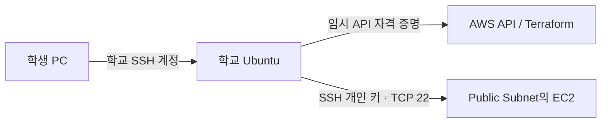

# Week 08 · 자원 참조·변수·출력과 EC2 접속 실습 가이드

[전체 실습 목록](../README.md) · [공통 준비](../common/README.md)

[← Week 07](../week07/README.md) · [Week 09 →](../week09/README.md)

지난주에는 VPC 한 개를 관리했습니다. 이번에는 **VPC → Subnet → 라우팅 → Security Group → EC2**를 참조로 연결하고, 생성된 공인 IP를 출력해 SSH로 접속합니다.

## 학습 목표

변수 선언·변수 값·출력을 구분하고 AWS API 인증, SSH 키, 인스턴스 프로파일의 역할을 설명합니다. 이론 50분 · 실습 75분 · 정리 15분.



EC2의 `LabInstanceProfile`은 EC2 내부 프로그램의 AWS 접근을 위한 기존 프로파일입니다. 학교 VM의 Terraform 인증이나 SSH 로그인 권한을 대신하지 않습니다.

## 실습 준비와 설정값

| 항목 | 설정값 |
| --- | --- |
| 실행 환경 | 학교 Ubuntu 24.04 · 일반 사용자 Bash |
| AWS 환경 | 본인의 AWS Academy Learner Lab |
| 리전 | 미국 동부(버지니아 북부) `us-east-1` |
| 수업 시간 | 140분 · 도구 설치는 사전에 완료 |
| 작업 폴더 | `~/cloud-infra/week08` |

[공통 준비](../common/README.md)의 도구 설치·인증을 완료합니다. 이전 주차 AWS 자원은 삭제하고 코드와 State는 보관합니다. 이번 주차 폴더에 이미 실습 파일이나 자원이 있다면 먼저 기존 실습의 정리 단계를 마칩니다.

**실행 위치는 별도 표시가 없는 한 학교 Ubuntu 일반 사용자입니다.** 아래 블록을 번호 순서대로 전체 복사합니다. EC2 안에 대화형으로 들어가서 다음 Terraform 명령을 실행하지 않도록 주의합니다.

## 실습 절차

### 01. (학교 Ubuntu · 일반 사용자) 환경 불러오기와 주차 폴더 준비

```bash
source "$HOME/.config/cloud-infra/env.sh"
aws sts get-caller-identity
mkdir -p "$HOME/cloud-infra/week08"
cd "$HOME/cloud-infra/week08"
pwd
```

**명령어 풀이**

- `source`로 도구 경로·전용 인증 파일·리전을 설정합니다.
- `Account`가 자신의 Learner Lab 콘솔 계정과 같은지 확인한 뒤 진행합니다.
- 이 주차 폴더에 `.tf` 코드와 State가 함께 저장됩니다. `sudo terraform`은 사용하지 않습니다.

**확인할 결과**

현재 경로가 `/home/자신의계정/cloud-infra/week08`입니다.

### 02. (학교 Ubuntu · 일반 사용자) EC2 접속용 키 준비

```bash
mkdir -p "$HOME/.ssh"
chmod 700 "$HOME/.ssh"
if [ ! -f "$HOME/.ssh/cloud-infra-lab" ]; then
  ssh-keygen -t ed25519 -f "$HOME/.ssh/cloud-infra-lab" -N '' -C "$(id -un)-cloud-infra"
fi
chmod 600 "$HOME/.ssh/cloud-infra-lab"
ssh-keygen -lf "$HOME/.ssh/cloud-infra-lab.pub"
```

**명령어 풀이**

- 개인 키는 학교 VM 안에 보관합니다. `.pub` 공개 키만 AWS에 등록합니다.
- `-t ed25519`는 키 형식, `-f`는 저장 위치, `-N ''`는 이 수업용 키의 암호를 비워 두는 옵션입니다.
- `if`는 이미 있는 키를 덮어쓰지 않도록 합니다. 같은 키를 다음 주에도 재사용합니다.
- 마지막 명령은 공개 키의 지문을 보여 줍니다. 개인 키 내용을 화면에 출력하지 않습니다.

**확인할 결과**

키 지문이 표시됩니다. 이 개인 키는 Learner Lab 임시 API 키와 다른 용도입니다.

### 03. (학교 Ubuntu · 일반 사용자) providers.tf 작성

```bash
cat > providers.tf <<'EOF'
terraform {
  required_version = "= 1.17.1"
  required_providers {
    aws = {
      source  = "hashicorp/aws"
      version = "= 6.71.0"
    }
  }
}

provider "aws" {
  region = "us-east-1"
  default_tags {
    tags = {
      Course = "cloud-infra"
      Week   = "08"
    }
  }
}
EOF
```

**명령어 풀이**

Provider 버전과 리전을 고정하고 생성 자원에 Course·Week 태그를 붙입니다.

**확인할 결과**

성공하면 별도 출력이 없습니다. `cat providers.tf`로 작성한 내용을 읽을 수 있습니다. 코드 블록은 첫 `cat`부터 마지막 `EOF`까지 전체를 복사합니다.

### 04. (학교 Ubuntu · 일반 사용자) variables.tf 작성

```bash
cat > variables.tf <<'EOF'
variable "name" {
  type = string
}
variable "vpc_cidr" {
  type    = string
  default = "10.70.0.0/16"
}
variable "ssh_cidr" {
  type = string
}
variable "public_key_path" {
  type    = string
  default = "~/.ssh/cloud-infra-lab.pub"
}
variable "ami_id" {
  type    = string
  default = "ami-0d6dd9e8265d48906"
}
variable "lesson_label" {
  type    = string
  default = "original"
}
EOF
```

**명령어 풀이**

- `type = string`은 문자열 입력입니다. `default`가 없는 변수는 값을 제공해야 합니다.
- `name`은 이름 접두어, `vpc_cidr`은 주소 범위, `ssh_cidr`은 접속을 허용할 출구 IP입니다.
- `ami_id`는 2026-11-03 us-east-1에서 검증한 Canonical Ubuntu 24.04 AMD64 AMI입니다. 다른 리전에 그대로 쓰지 않습니다.
- `public_key_path`는 학교 VM 공개 키의 경로입니다. 인스턴스 유형은 다음 코드에서 t3.micro로 제한합니다.

**확인할 결과**

성공하면 별도 출력이 없습니다. `cat variables.tf`로 작성한 내용을 읽을 수 있습니다. 코드 블록은 첫 `cat`부터 마지막 `EOF`까지 전체를 복사합니다.

### 05. (학교 Ubuntu · 일반 사용자) 실습 입력값 작성

```bash
cat > terraform.tfvars <<EOF
name         = "ci-$(id -un)-w08"
vpc_cidr     = "10.70.0.0/16"
lesson_label = "original"
EOF
```

**명령어 풀이**

- `terraform.tfvars`는 변수에 넣을 값을 적는 파일입니다. 파일 이름이 이와 같으면 자동으로 읽습니다.
- 여기서는 따옴표 없는 `<<EOF`를 사용해 `$(id -un)`이 현재 계정 이름으로 치환되게 합니다.
- `.tf`의 변수 선언은 입력 형식을 정하고, `.tfvars`는 이번 실행의 값을 정합니다.

### 06. (학교 Ubuntu · 일반 사용자) 학교 VM의 접속 주소를 변수 파일로 저장

```bash
ci_source_ip=$(curl -fsS https://checkip.amazonaws.com)
python3 - "$ci_source_ip" <<'PY'
import ipaddress, json, sys
address = str(ipaddress.IPv4Address(sys.argv[1].strip()))
with open("connection.auto.tfvars.json", "w") as f:
    json.dump({"ssh_cidr": address + "/32"}, f, indent=2)
print("허용할 학교 VM 출구 주소:", address + "/32")
PY
```

**명령어 풀이**

- `$(...)`는 명령 결과를 셸 변수에 넣습니다. 여기서는 학교 VM에서 AWS로 나가는 공인 주소를 구합니다.
- Python은 IPv4 형식을 확인하고 Terraform이 자동으로 읽는 `.auto.tfvars.json` 파일을 만듭니다.
- `/32`는 해당 주소 하나만 뜻합니다. SSH를 전 세계에 열지 않습니다.
- 같은 학교 출구 주소를 공유하는 환경이면 다른 학교 사용자도 네트워크 접근은 가능하지만 로그인에는 자신의 개인 키가 필요합니다.

**확인할 결과**

자신의 실행 환경에서 조회한 IPv4/32가 나옵니다. IP가 바뀌면 이 단계부터 다시 실행하고 plan/apply합니다.

### 07. (학교 Ubuntu · 일반 사용자) network.tf 작성

```bash
cat > network.tf <<'EOF'
resource "aws_vpc" "lab" {
  cidr_block           = var.vpc_cidr
  enable_dns_hostnames = true
  tags = {
    Name   = var.name
    Lesson = var.lesson_label
  }
}

resource "aws_subnet" "public" {
  vpc_id                  = aws_vpc.lab.id
  cidr_block              = cidrsubnet(var.vpc_cidr, 8, 0)
  availability_zone       = "us-east-1a"
  map_public_ip_on_launch = true
  tags = { Name = "${var.name}-public" }
}

resource "aws_internet_gateway" "lab" {
  vpc_id = aws_vpc.lab.id
  tags   = { Name = var.name }
}

resource "aws_route_table" "public" {
  vpc_id = aws_vpc.lab.id
  route {
    cidr_block = "0.0.0.0/0"
    gateway_id = aws_internet_gateway.lab.id
  }
  tags = { Name = "${var.name}-public" }
}

resource "aws_route_table_association" "public" {
  subnet_id      = aws_subnet.public.id
  route_table_id = aws_route_table.public.id
}

resource "aws_security_group" "web" {
  name_prefix = "${var.name}-"
  description = "Cloud infrastructure class"
  vpc_id      = aws_vpc.lab.id
  tags        = { Name = var.name }
}

resource "aws_vpc_security_group_ingress_rule" "ssh" {
  security_group_id = aws_security_group.web.id
  cidr_ipv4         = var.ssh_cidr
  from_port         = 22
  to_port           = 22
  ip_protocol       = "tcp"
}

resource "aws_vpc_security_group_egress_rule" "outbound" {
  security_group_id = aws_security_group.web.id
  cidr_ipv4         = "0.0.0.0/0"
  ip_protocol       = "-1"
}
EOF
```

**명령어 풀이**

- `vpc_id = aws_vpc.lab.id`는 문자열 ID를 손으로 복사하는 대신 자원을 참조합니다. Terraform이 의존 순서를 계산합니다.
- `cidrsubnet(..., 8, 0)`은 /16을 /24로 나누어 첫 범위를 선택합니다.
- Public Subnet에는 Internet Gateway로 향하는 기본 경로와 공인 IP가 함께 필요합니다.
- Route Table을 만든 것만으로 끝나지 않고 association으로 서브넷에 연결합니다.
- SG의 22번 포트는 학교 출구 IP 하나만 허용하고, 아웃바운드는 패키지 다운로드 등에 필요하도록 허용합니다.

**확인할 결과**

성공하면 별도 출력이 없습니다. `cat network.tf`로 작성한 내용을 읽을 수 있습니다. 코드 블록은 첫 `cat`부터 마지막 `EOF`까지 전체를 복사합니다.

### 08. (학교 Ubuntu · 일반 사용자) compute.tf 작성

```bash
cat > compute.tf <<'EOF'
resource "aws_key_pair" "lab" {
  key_name_prefix = "${var.name}-"
  public_key      = file(pathexpand(var.public_key_path))
}

resource "aws_instance" "web" {
  ami                         = var.ami_id
  instance_type               = "t3.micro"
  subnet_id                   = aws_subnet.public.id
  vpc_security_group_ids      = [aws_security_group.web.id]
  key_name                    = aws_key_pair.lab.key_name
  iam_instance_profile        = "LabInstanceProfile"
  associate_public_ip_address = true

  root_block_device {
    volume_type           = "gp3"
    volume_size           = 8
    encrypted             = true
    delete_on_termination = true
  }
  metadata_options {
    http_tokens = "required"
  }
  tags = { Name = "${var.name}-web" }
  depends_on = [aws_route_table_association.public]
}
EOF
```

**명령어 풀이**

- `file(pathexpand(...))`는 `~`를 홈 경로로 해석하고 공개 키 파일을 읽습니다.
- Key Pair 등록에는 공개 키만 전송합니다. 개인 키는 학교 VM에 남습니다.
- `subnet_id`, `vpc_security_group_ids`, `key_name`이 앞의 자원을 참조합니다.
- 기존 `LabInstanceProfile`을 사용하며 새 IAM 역할을 만들지 않습니다.
- 루트 디스크는 암호화한 8GiB gp3이며 인스턴스 삭제 시 함께 삭제합니다.
- `depends_on`은 서브넷 라우팅 연결 완료 후 서버를 만들게 합니다. 일반 자원 참조로 표현되는 의존성은 별도로 적을 필요가 없습니다.

**확인할 결과**

성공하면 별도 출력이 없습니다. `cat compute.tf`로 작성한 내용을 읽을 수 있습니다. 코드 블록은 첫 `cat`부터 마지막 `EOF`까지 전체를 복사합니다.

### 09. (학교 Ubuntu · 일반 사용자) outputs.tf 작성

```bash
cat > outputs.tf <<'EOF'
output "vpc_id" {
  value = aws_vpc.lab.id
}
output "instance_id" {
  value = aws_instance.web.id
}
output "public_ip" {
  value = aws_instance.web.public_ip
}
EOF
```

**명령어 풀이**

VPC ID·인스턴스 ID·공인 IP를 이름으로 조회할 수 있게 합니다. 최초 계획에서 IP가 `(known after apply)`로 보이는 것은 생성 후 결정되기 때문입니다.

**확인할 결과**

성공하면 별도 출력이 없습니다. `cat outputs.tf`로 작성한 내용을 읽을 수 있습니다. 코드 블록은 첫 `cat`부터 마지막 `EOF`까지 전체를 복사합니다.

### 10. (학교 Ubuntu · 일반 사용자) 초기화·형식 정리·문법 확인

```bash
terraform init
terraform fmt -recursive
terraform validate
```

**명령어 풀이**

- `init`은 Provider와 모듈을 준비하고 `.terraform.lock.hcl`에 Provider 선택을 기록합니다.
- `fmt`는 들여쓰기를 정리합니다. `validate`는 구성의 문법과 참조를 확인하지만 AWS 생성 권한까지 확인하지는 않습니다.

**확인할 결과**

`Success! The configuration is valid.`가 표시됩니다.

### 11. (학교 Ubuntu · 일반 사용자) 처음 생성할 자원의 계획 확인

```bash
terraform plan -out=create.tfplan
```

**명령어 풀이**

- `plan`은 코드·State·AWS의 현재 상태를 비교합니다. 이 단계는 자원을 생성·변경하지 않습니다.
- `+`는 생성, `~`는 제자리 수정, `-`는 삭제, `-/+`는 교체입니다.
- `-out`은 이 계획을 저장합니다. 예상과 다르면 다음 apply를 실행하지 않습니다.

**확인할 결과**

Plan: 10 to add, 0 to change, 0 to destroy.

### 12. (학교 Ubuntu · 일반 사용자) 검토한 계획 적용

```bash
terraform apply create.tfplan
```

**명령어 풀이**

- 저장된 계획을 적용합니다. 추가 `yes` 질문이 없으므로 **직전 계획을 검토한 뒤** 실행합니다.
- 실행 중에는 Ctrl+C로 중단하지 말고 완료를 기다립니다. 오류가 나면 State를 지우지 말고 원인을 해결한 뒤 새로 plan합니다.

**확인할 결과**

`Apply complete!`와 변경 수가 표시됩니다. 출력 주소와 ID는 계정·실행마다 다릅니다.

### 13. (학교 Ubuntu · 일반 사용자) 서버 준비 상태 기다리기

```bash
terraform output
ci_instance_id=$(terraform output -raw instance_id)
aws ec2 wait instance-status-ok --instance-ids "$ci_instance_id"
printf 'EC2 상태 검사 통과
'
```

**명령어 풀이**

- `output`은 State의 출력값을 읽습니다. AWS를 실시간으로 새로 조회하는 명령이 아닙니다.
- `aws ec2 wait`는 AWS의 상태 검사가 통과할 때까지 기다립니다. 수 분간 출력이 없어도 정상입니다.
- 오래 실패하면 EC2 콘솔에서 인스턴스 상태·상태 검사·시스템 로그를 확인합니다.

### 14. (학교 Ubuntu · 일반 사용자) 학교 VM에서 EC2에 원격 명령 실행

```bash
ci_public_ip=$(terraform output -raw public_ip)
ssh -i "$HOME/.ssh/cloud-infra-lab" -o IdentitiesOnly=yes -o StrictHostKeyChecking=accept-new -o UserKnownHostsFile=./known_hosts "ubuntu@$ci_public_ip" 'hostname; id -un; cloud-init status --wait'
```

**명령어 풀이**

- `-i`는 로그인에 사용할 개인 키입니다. Ubuntu AMI의 기본 OS 계정은 `ubuntu`입니다.
- `IdentitiesOnly=yes`는 지정한 키를 사용하게 합니다.
- `accept-new`는 처음 만난 서버 키를 이 주차 `known_hosts`에 기록하고, 이미 기록된 키가 바뀌면 거부합니다. 실습에서 첫 접속을 신뢰하는 방식이며 엄격한 서버 신원 검증이 필요한 환경에서는 지문을 별도 확인해야 합니다.
- 끝의 작은따옴표 안 명령만 EC2에서 실행하고 자동으로 학교 VM 프롬프트로 돌아옵니다.
- `cloud-init status --wait`는 Ubuntu 초기 설정 완료를 기다립니다. 이번 주에는 웹 서버를 설치하지 않습니다.

**확인할 결과**

서버의 hostname, ubuntu, status: done이 표시됩니다.

### 15. (학교 Ubuntu · 일반 사용자) 다시 실행해 변경 없음 확인

```bash
terraform plan
```

**명령어 풀이**

- 같은 코드를 다시 실행해도 자원이 반복 생성되지 않는지 확인합니다.
- 외부 변경·인증 만료·잘못된 폴더 때문에 다른 결과가 나올 수 있으므로 실제 문구를 읽습니다.

**확인할 결과**

`No changes. Your infrastructure matches the configuration.`

## 자원 정리 — 제출 전에 수행

이 단계는 현재 폴더의 State가 관리하는 자원을 삭제합니다. 다른 주차 폴더에서 실행하지 않습니다. `terraform destroy`는 삭제 계획과 확인을 한 명령으로 수행하는 명령입니다. 여기서는 삭제 대상을 파일로 저장해 읽은 뒤 적용하는 같은 목적의 두 단계 절차를 사용합니다.

### 16. (학교 Ubuntu · 일반 사용자) 삭제 대상 확인

```bash
terraform plan -destroy -out=cleanup.tfplan
```

**명령어 풀이**

- `plan`은 코드·State·AWS의 현재 상태를 비교합니다. 이 단계는 자원을 생성·변경하지 않습니다.
- `+`는 생성, `~`는 제자리 수정, `-`는 삭제, `-/+`는 교체입니다.
- `-out`은 이 계획을 저장합니다. 예상과 다르면 다음 apply를 실행하지 않습니다.

**확인할 결과**

Plan: 0 to add, 0 to change, 10 to destroy.

### 17. (학교 Ubuntu · 일반 사용자) 검토한 계획 적용

```bash
terraform apply cleanup.tfplan
```

**명령어 풀이**

- 저장된 계획을 적용합니다. 추가 `yes` 질문이 없으므로 **직전 계획을 검토한 뒤** 실행합니다.
- 실행 중에는 Ctrl+C로 중단하지 말고 완료를 기다립니다. 오류가 나면 State를 지우지 말고 원인을 해결한 뒤 새로 plan합니다.

**확인할 결과**

`Apply complete!`와 변경 수가 표시됩니다. 출력 주소와 ID는 계정·실행마다 다릅니다.

### 18. (학교 Ubuntu · 일반 사용자) 관리 자원이 남아 있지 않은지 확인

```bash
terraform state list
```

**명령어 풀이**

- 출력에 `aws_...` 또는 `module....aws_...`로 시작하는 관리 자원이 없어야 합니다.
- 코드·잠금 파일·비어 있는 State는 보관합니다. State를 지우는 것은 AWS 자원을 삭제하는 작업이 아닙니다.
- 구성 파일을 남겨 두었기 때문에 정리 후 일반 `terraform plan`을 실행하면 다시 생성할 계획이 나오는 것이 정상입니다.

**확인할 결과**

이번 구성에서는 아무 자원 주소도 출력되지 않습니다.

## 제출 및 확인 질문

- 자원 간 참조 세 가지와 그로 인해 생기는 생성 순서를 설명합니다.
- SSH 실행 결과와 삭제 완료·빈 state list를 제출합니다.
- AWS 임시 키, EC2 SSH 개인 키, LabInstanceProfile을 각각 어디서 사용하는지 설명합니다.

제출 화면에는 비밀번호·Access Key·Secret Key·Session Token·개인 키·State 원문을 포함하지 않습니다. `.tf` 코드와 본인이 정리한 결과를 제출합니다. 계정 ID·IP가 포함된 화면은 수업 제출 범위에서만 사용합니다.

## 막혔을 때

| 증상 | 확인 및 해결 |
| --- | --- |
| SSH timeout | 학교 VM에서 실행했는지, 현재 출구 IP와 ssh_cidr이 같은지, 공인 IP·기본 경로·SG 22번 허용 확인 |
| Permission denied (publickey) | 사용자 ubuntu, 개인 키 경로, 해당 공개 키로 생성한 EC2인지 확인 |
| InvalidAMIID.NotFound | 리전 us-east-1과 AMI 사용 가능 여부 확인. 교수자가 Canonical 소유의 Ubuntu 24.04 AMD64 AMI를 재검증한 후 수정 |
| Invalid IAM Instance Profile / AccessDenied | 기존 LabInstanceProfile 제공 여부와 현재 Lab 권한 확인. 새 IAM 역할 생성으로 우회하지 않음 |
| 잠시 Connection refused | 상태 검사와 cloud-init 초기화를 기다린 후 같은 SSH 명령 재실행 |
| HOST IDENTIFICATION HAS CHANGED | EC2를 재생성했는지 콘솔 ID·IP를 확인한 뒤 해당 IP의 known_hosts 항목만 갱신. 전체 검사를 끄지 않음 |

공통 인증·설치 오류는 [공통 준비의 문제 해결](../common/README.md#막혔을-때)을 확인합니다. 실제 검증 범위와 남은 제한은 [검증 리포트](../VERIFICATION.md)에 기록합니다.

---

[← Week 07](../week07/README.md) · [Week 09 →](../week09/README.md)
