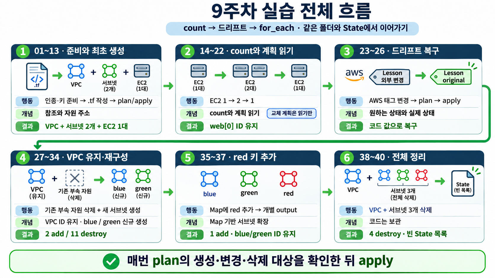
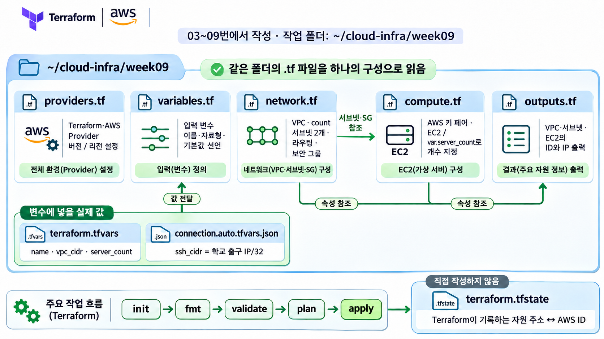
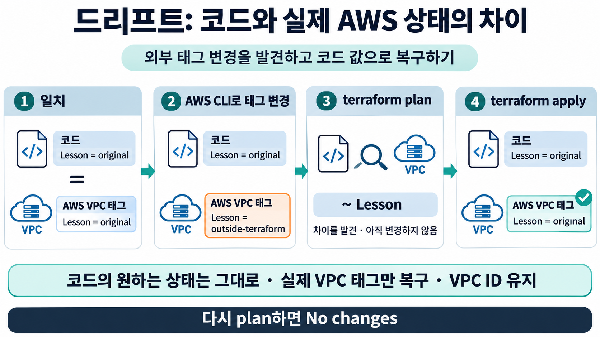
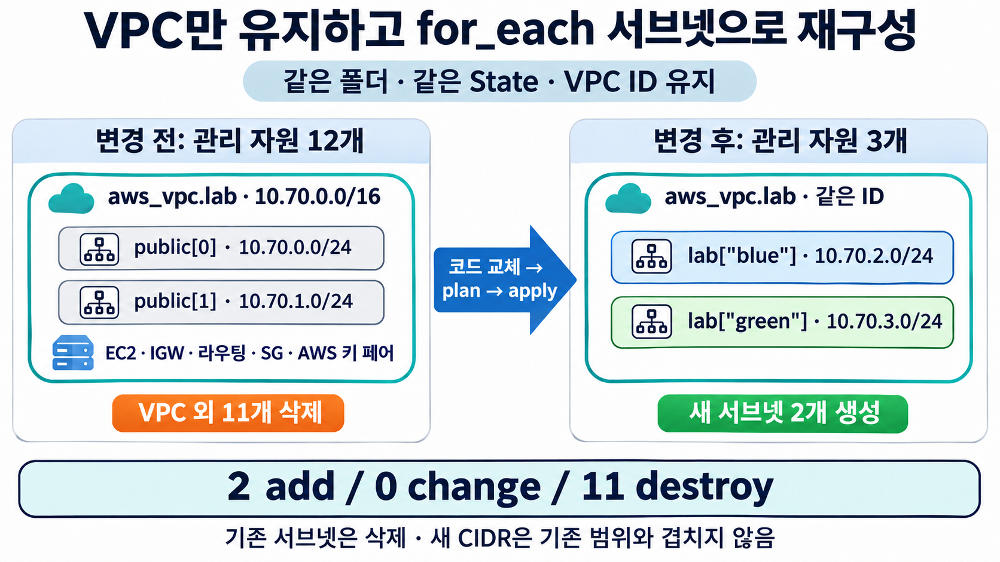
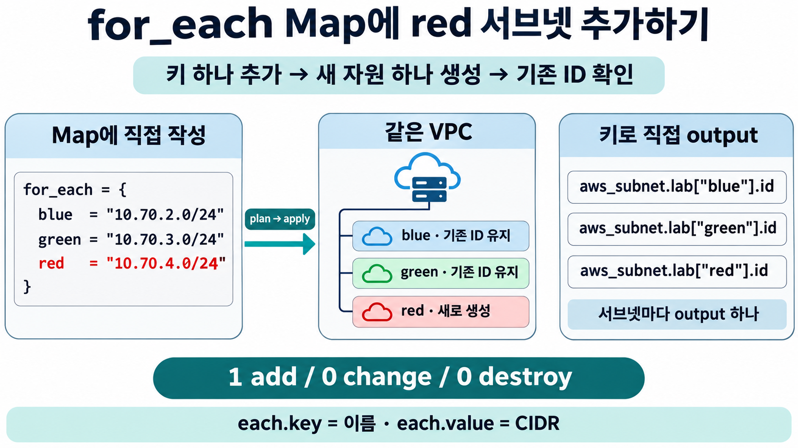

# Week 09 · count·for_each와 State·드리프트 관리 실습 가이드



[전체 실습 목록](../README.md) · [공통 준비](../common/README.md)

[← Week 08](../week08/README.md) · [Week 10 →](../week10/README.md)

이번에는 서로 다른 AZ에 서브넷 두 개를 만들고 **EC2 1대 → 2대 → 1대**로 변경합니다. 이어 Terraform 밖에서 태그를 바꾼 뒤 차이를 발견하고 코드 값으로 복구합니다.

## 학습 목표

`count.index`·리스트·자원 주소를 읽고, 생성·수정·삭제·교체 계획을 구분합니다. 이어 이름이 있는 서브넷을 `for_each`로 만들어 두 방식의 식별 기준을 비교합니다. **VPC는 유지하고 나머지 기존 자원을 새 for_each 서브넷 구성으로 교체하는 과정까지 필수**입니다.

140분 배분: 이론·코드 읽기 35분 · count/State/드리프트 55분 · for_each 전환과 비교 35분 · 정리와 결과 확인 15분. 시간은 수업 설계 기준이며 도구 설치는 사전에 완료합니다.

8주차 자원이 남아 있다면 해당 주차의 정리를 마치고 시작합니다. 자동 삭제된 경우 별도 삭제는 생략합니다. 이번 주는 **같은 `week09` 폴더와 State에서 끝까지 진행**하며, 중간 apply에서 VPC 이외의 기존 관리 자원을 삭제하고 새 서브넷을 만듭니다. VPC를 포함한 전체 정리는 맨 마지막에 수행합니다.

흐름: **EC2 1→2→1 → 태그 드리프트 복구 → VPC만 유지하며 for_each 서브넷으로 재구성 → red 서브넷 추가 → 전체 정리**.

검증 안내: 앞부분의 기존 실습은 AWS 실행 검증을 마쳤습니다. 2026-11-19에 추가한 VPC 유지·재구성은 로컬 검증 범위를 [검증 리포트](../VERIFICATION.md)에 구분합니다. 실제 계정에서는 전환 계획의 삭제·생성 수와 적용 후 ID를 반드시 확인합니다.

## 실습 준비와 설정값

| 항목 | 설정값 |
| --- | --- |
| 실행 환경 | 학교 Ubuntu 24.04 · 일반 사용자 Bash |
| AWS 환경 | 본인의 AWS Academy Learner Lab |
| 리전 | 미국 동부(버지니아 북부) `us-east-1` |
| 수업 시간 | 140분 · 도구 설치는 사전에 완료 |
| 작업 폴더 | `~/cloud-infra/week09` |

처음 시작하거나 학교 VM이 초기화된 학생은 [공통 준비](../common/README.md)를 처음부터 수행합니다. 같은 VM·계정의 설치와 설정이 유지된 학생은 Lab 시작·Ready 확인 후 [08. 임시 인증 저장](../common/README.md#08-임시-인증-저장)과 09번 계정 확인부터 수행합니다. 이전 주차 AWS 자원은 삭제하고 코드와 State는 보관합니다. 이번 주차 폴더에 이미 실습 파일이나 자원이 있다면 먼저 기존 실습의 정리 단계를 마칩니다.

**실행 위치는 별도 표시가 없는 한 학교 Ubuntu 일반 사용자입니다.** 아래 블록을 번호 순서대로 전체 복사합니다. EC2 안에 대화형으로 들어가서 다음 Terraform 명령을 실행하지 않도록 주의합니다.

## 실습 절차

### 01. (학교 Ubuntu · 일반 사용자) 환경 불러오기와 주차 폴더 준비

```bash
source "$HOME/.config/cloud-infra/env.sh"
aws sts get-caller-identity
mkdir -p "$HOME/cloud-infra/week09"
cd "$HOME/cloud-infra/week09"
pwd
```

**명령어 풀이**

- `source`로 도구 경로·전용 인증 파일·리전을 설정합니다.
- `Account`가 자신의 Learner Lab 콘솔 계정과 같은지 확인한 뒤 진행합니다.
- 이 주차 폴더에 `.tf` 코드와 State가 함께 저장됩니다. `sudo terraform`은 사용하지 않습니다.

**확인할 결과**

현재 경로가 `/home/자신의계정/cloud-infra/week09`입니다.

### 02. (학교 Ubuntu · 일반 사용자) EC2 접속용 키 준비

```bash
mkdir -p "$HOME/.ssh"
chmod 700 "$HOME/.ssh"
if [ ! -f "$HOME/.ssh/cloud-infra-lab" ]; then
  ssh-keygen -t ed25519 -f "$HOME/.ssh/cloud-infra-lab" -N '' -C "$(id -un)-cloud-infra"
fi
chmod 600 "$HOME/.ssh/cloud-infra-lab"
ssh-keygen -lf "$HOME/.ssh/cloud-infra-lab.pub"
```

**명령어 풀이**

- 개인 키는 학교 VM 안에 보관합니다. `.pub` 공개 키만 AWS에 등록합니다.
- `-t ed25519`는 키 형식, `-f`는 저장 위치, `-N ''`는 이 수업용 키의 암호를 비워 두는 옵션입니다.
- `if`는 이미 있는 키를 덮어쓰지 않도록 합니다. 같은 키를 다음 주에도 재사용합니다.
- 마지막 명령은 공개 키의 지문을 보여 줍니다. 개인 키 내용을 화면에 출력하지 않습니다.

**확인할 결과**

키 지문이 표시됩니다. 이 개인 키는 Learner Lab 임시 API 키와 다른 용도입니다.

### 03. (학교 Ubuntu · 일반 사용자) providers.tf 작성



이제 03~09번에서 같은 `week09` 폴더에 파일들을 작성합니다. **파일 이름 순서로 실행되는 것이 아니라, 현재 폴더의 `.tf` 파일들을 하나의 구성으로 읽습니다.** `terraform.tfvars`와 `connection.auto.tfvars.json`은 변수에 실제 값을 제공하며, `terraform.tfstate`는 직접 작성하지 않습니다.

```bash
cat > providers.tf <<'EOF'
terraform {
  required_version = "= 1.17.1"
  required_providers {
    aws = {
      source  = "hashicorp/aws"
      version = "= 6.71.0"
    }
  }
}

provider "aws" {
  region = "us-east-1"
  default_tags {
    tags = {
      Course = "cloud-infra"
      Week   = "09"
    }
  }
}
EOF
```

**명령어 풀이**

같은 버전을 사용하고 주차 태그를 09로 구분합니다.

**확인할 결과**

성공하면 별도 출력이 없습니다. `cat providers.tf`로 작성한 내용을 읽을 수 있습니다. 코드 블록은 첫 `cat`부터 마지막 `EOF`까지 전체를 복사합니다.

### 04. (학교 Ubuntu · 일반 사용자) variables.tf 작성

```bash
cat > variables.tf <<'EOF'
variable "name" {
  type = string
}
variable "vpc_cidr" {
  type    = string
  default = "10.70.0.0/16"
}
variable "ssh_cidr" {
  type = string
}
variable "public_key_path" {
  type    = string
  default = "~/.ssh/cloud-infra-lab.pub"
}
variable "ami_id" {
  type    = string
  default = "ami-0d6dd9e8265d48906"
}
variable "lesson_label" {
  type    = string
  default = "original"
}

variable "server_count" {
  type    = number
  default = 1
  validation {
    condition     = contains([1, 2], var.server_count)
    error_message = "server_count 는 1 또는 2여야 합니다."
  }
}
EOF
```

**명령어 풀이**

8주차 변수에 `server_count`를 추가합니다. 기본값은 1이고 validation으로 1 또는 2만 허용합니다. 학생별 인스턴스 수가 불필요하게 늘어나는 것을 막습니다.

**확인할 결과**

성공하면 별도 출력이 없습니다. `cat variables.tf`로 작성한 내용을 읽을 수 있습니다. 코드 블록은 첫 `cat`부터 마지막 `EOF`까지 전체를 복사합니다.

### 05. (학교 Ubuntu · 일반 사용자) 실습 입력값 작성

```bash
cat > terraform.tfvars <<EOF
name         = "ci-$(id -un)-w09"
vpc_cidr     = "10.70.0.0/16"
lesson_label = "original"
server_count = 1
EOF
```

**명령어 풀이**

- `terraform.tfvars`는 변수에 넣을 값을 적는 파일입니다. 파일 이름이 이와 같으면 자동으로 읽습니다.
- 여기서는 따옴표 없는 `<<EOF`를 사용해 `$(id -un)`이 현재 계정 이름으로 치환되게 합니다.
- `.tf`의 변수 선언은 입력 형식을 정하고, `.tfvars`는 이번 실행의 값을 정합니다.

### 06. (학교 Ubuntu · 일반 사용자) 학교 VM의 접속 주소를 변수 파일로 저장

```bash
ci_source_ip=$(curl -fsS https://checkip.amazonaws.com)
python3 - "$ci_source_ip" <<'PY'
import ipaddress, json, sys
address = str(ipaddress.IPv4Address(sys.argv[1].strip()))
with open("connection.auto.tfvars.json", "w") as f:
    json.dump({"ssh_cidr": address + "/32"}, f, indent=2)
print("허용할 학교 VM 출구 주소:", address + "/32")
PY
```

**명령어 풀이**

- `$(...)`는 명령 결과를 셸 변수에 넣습니다. 여기서는 학교 VM에서 AWS로 나가는 공인 주소를 구합니다.
- Python은 IPv4 형식을 확인하고 Terraform이 자동으로 읽는 `.auto.tfvars.json` 파일을 만듭니다.
- `/32`는 해당 주소 하나만 뜻합니다. SSH를 전 세계에 열지 않습니다.
- 같은 학교 출구 주소를 공유하는 환경이면 다른 학교 사용자도 네트워크 접근은 가능하지만 로그인에는 자신의 개인 키가 필요합니다.

**확인할 결과**

자신의 실행 환경에서 조회한 IPv4/32가 나옵니다. IP가 바뀌면 이 단계부터 다시 실행하고 plan/apply합니다.

### 07. (학교 Ubuntu · 일반 사용자) network.tf 작성

```bash
cat > network.tf <<'EOF'
resource "aws_vpc" "lab" {
  cidr_block           = var.vpc_cidr
  enable_dns_hostnames = true
  tags = {
    Name   = var.name
    Lesson = var.lesson_label
  }
}

resource "aws_subnet" "public" {
  count                   = 2
  vpc_id                  = aws_vpc.lab.id
  cidr_block              = cidrsubnet(var.vpc_cidr, 8, count.index)
  availability_zone       = ["us-east-1a", "us-east-1b"][count.index]
  map_public_ip_on_launch = true
  tags = { Name = "${var.name}-public-${count.index + 1}" }
}

resource "aws_internet_gateway" "lab" {
  vpc_id = aws_vpc.lab.id
  tags   = { Name = var.name }
}

resource "aws_route_table" "public" {
  vpc_id = aws_vpc.lab.id
  route {
    cidr_block = "0.0.0.0/0"
    gateway_id = aws_internet_gateway.lab.id
  }
  tags = { Name = "${var.name}-public" }
}

resource "aws_route_table_association" "public" {
  count          = 2
  subnet_id      = aws_subnet.public[count.index].id
  route_table_id = aws_route_table.public.id
}

resource "aws_security_group" "web" {
  name_prefix = "${var.name}-"
  description = "Cloud infrastructure class"
  vpc_id      = aws_vpc.lab.id
  tags        = { Name = var.name }
}

resource "aws_vpc_security_group_ingress_rule" "ssh" {
  security_group_id = aws_security_group.web.id
  cidr_ipv4         = var.ssh_cidr
  from_port         = 22
  to_port           = 22
  ip_protocol       = "tcp"
}

resource "aws_vpc_security_group_egress_rule" "outbound" {
  security_group_id = aws_security_group.web.id
  cidr_ipv4         = "0.0.0.0/0"
  ip_protocol       = "-1"
}
EOF
```

**명령어 풀이**

- `count = 2`는 같은 자원을 두 개 만듭니다. 주소는 `[0]`, `[1]`로 구분합니다.
- `count.index`는 0부터 시작합니다. 서브넷 CIDR은 10.70.0.0/24, 10.70.1.0/24가 됩니다.
- AZ 리스트에서 같은 인덱스를 골라 us-east-1a와 us-east-1b에 배치합니다. AZ 이름은 계정별 물리 위치를 동일하게 보장하지는 않습니다.
- Route Table association도 두 개를 만들어 각 서브넷에 연결합니다.

**확인할 결과**

성공하면 별도 출력이 없습니다. `cat network.tf`로 작성한 내용을 읽을 수 있습니다. 코드 블록은 첫 `cat`부터 마지막 `EOF`까지 전체를 복사합니다.

### 08. (학교 Ubuntu · 일반 사용자) compute.tf 작성

```bash
cat > compute.tf <<'EOF'
resource "aws_key_pair" "lab" {
  key_name_prefix = "${var.name}-"
  public_key      = file(pathexpand(var.public_key_path))
}

resource "aws_instance" "web" {
  count                       = var.server_count
  ami                         = var.ami_id
  instance_type               = "t3.micro"
  subnet_id                   = aws_subnet.public[count.index].id
  vpc_security_group_ids      = [aws_security_group.web.id]
  key_name                    = aws_key_pair.lab.key_name
  iam_instance_profile        = "LabInstanceProfile"
  associate_public_ip_address = true

  root_block_device {
    volume_type           = "gp3"
    volume_size           = 8
    encrypted             = true
    delete_on_termination = true
  }
  metadata_options {
    http_tokens = "required"
  }
  tags = { Name = "${var.name}-web-${count.index + 1}" }
  depends_on = [aws_route_table_association.public]
}
EOF
```

**명령어 풀이**

- EC2의 `count = var.server_count`를 바꾸면 관리할 대수가 달라집니다.
- 첫 서버는 서브넷 `[0]`, 둘째는 `[1]`을 참조합니다.
- Name 태그는 index에 1을 더해 web-1, web-2로 읽기 쉽게 표시하지만 Terraform 주소는 계속 `[0]`, `[1]`입니다.
- 목록 중간의 항목을 지우거나 순서를 바꾸면 인덱스 기반 자원 대응이 달라질 수 있습니다. 이번에는 마지막 서버만 증감합니다.

**확인할 결과**

성공하면 별도 출력이 없습니다. `cat compute.tf`로 작성한 내용을 읽을 수 있습니다. 코드 블록은 첫 `cat`부터 마지막 `EOF`까지 전체를 복사합니다.

### 09. (학교 Ubuntu · 일반 사용자) outputs.tf 작성

```bash
cat > outputs.tf <<'EOF'
output "vpc_id" {
  value = aws_vpc.lab.id
}
output "instance_ids" {
  value = aws_instance.web[*].id
}
output "public_ips" {
  value = aws_instance.web[*].public_ip
}
output "subnet_ids" {
  value = aws_subnet.public[*].id
}
EOF
```

**명령어 풀이**

`[*]`는 여러 인스턴스의 속성을 리스트로 모읍니다. 문자열 하나였던 지난주 출력과 형식이 달라집니다.

**확인할 결과**

성공하면 별도 출력이 없습니다. `cat outputs.tf`로 작성한 내용을 읽을 수 있습니다. 코드 블록은 첫 `cat`부터 마지막 `EOF`까지 전체를 복사합니다.

### 10. (학교 Ubuntu · 일반 사용자) 초기화·형식 정리·문법 확인

```bash
terraform init
terraform fmt -recursive
terraform validate
```

**명령어 풀이**

- `init`은 Provider와 모듈을 준비하고 `.terraform.lock.hcl`에 Provider 선택을 기록합니다.
- `fmt`는 들여쓰기를 정리합니다. `validate`는 구성의 문법과 참조를 확인하지만 AWS 생성 권한까지 확인하지는 않습니다.

**확인할 결과**

`Success! The configuration is valid.`가 표시됩니다.

### 11. (학교 Ubuntu · 일반 사용자) 처음 생성할 자원의 계획 확인

```bash
terraform plan -out=create.tfplan
```

**명령어 풀이**

- `plan`은 코드·State·AWS의 현재 상태를 비교합니다. 이 단계는 자원을 생성·변경하지 않습니다.
- `+`는 생성, `~`는 제자리 수정, `-`는 삭제, `-/+`는 교체입니다.
- `-out`은 이 계획을 저장합니다. 예상과 다르면 다음 apply를 실행하지 않습니다.

**확인할 결과**

Plan: 12 to add, 0 to change, 0 to destroy.

### 12. (학교 Ubuntu · 일반 사용자) 검토한 계획 적용

```bash
terraform apply create.tfplan
```

**명령어 풀이**

- 저장된 계획을 적용합니다. 추가 `yes` 질문이 없으므로 **직전 계획을 검토한 뒤** 실행합니다.
- 실행 중에는 Ctrl+C로 중단하지 말고 완료를 기다립니다. 오류가 나면 State를 지우지 말고 원인을 해결한 뒤 새로 plan합니다.

**확인할 결과**

`Apply complete!`와 변경 수가 표시됩니다. 출력 주소와 ID는 계정·실행마다 다릅니다.

### 13. (학교 Ubuntu · 일반 사용자) 자원 주소와 두 AZ 확인

```bash
terraform state list
terraform state show 'aws_instance.web[0]'
ci_subnets=$(terraform output -json subnet_ids | python3 -c 'import json,sys; print(" ".join(json.load(sys.stdin)))')
aws ec2 describe-subnets --subnet-ids $ci_subnets --query 'Subnets[].{ID:SubnetId,AZ:AvailabilityZone,CIDR:CidrBlock}'
terraform output -json instance_ids > first-instance.json
```

**명령어 풀이**

- 대괄호가 있는 자원 주소는 셸 해석을 막기 위해 작은따옴표로 감쌉니다.
- `output -json`은 프로그램이 읽기 좋은 JSON으로 출력합니다.
- `$ci_subnets`는 AWS CLI에 여러 ID를 별도 인자로 전달하기 위해 이 위치에서 의도적으로 따옴표 없이 사용합니다. 값의 출처는 Terraform ID 리스트입니다.
- 첫 EC2 ID를 파일로 저장해 증감 후에도 유지되는지 비교합니다.

**확인할 결과**

서브넷 두 개가 서로 다른 AZ와 /24 CIDR을 가집니다.

## 실습 미리 보기 · count로 EC2 1→2→1 조절

![server_count를 1에서 2로 늘리면 web[1]만 추가되고 다시 1로 줄이면 web[1]만 삭제됩니다. web[0]의 ID는 계속 유지됩니다.](assets/count-scale.png)

14~21번에서는 **개수 변경 → plan 확인 → apply → 첫 서버 ID 비교**를 수행합니다. `count`는 숫자 인덱스로 자원을 구분하며, 이번에는 마지막 인스턴스만 추가·삭제합니다.

### 14. (학교 Ubuntu · 일반 사용자) 서버 수를 2로 변경

```bash
sed -i 's/server_count = 1/server_count = 2/' terraform.tfvars
```

**명령어 풀이**

반복 자원 블록을 복사하지 않고 입력값 하나만 바꿉니다.

### 15. (학교 Ubuntu · 일반 사용자) 변경 계획 확인

```bash
terraform plan -out=scale-out.tfplan
```

**명령어 풀이**

- `plan`은 코드·State·AWS의 현재 상태를 비교합니다. 이 단계는 자원을 생성·변경하지 않습니다.
- `+`는 생성, `~`는 제자리 수정, `-`는 삭제, `-/+`는 교체입니다.
- `-out`은 이 계획을 저장합니다. 예상과 다르면 다음 apply를 실행하지 않습니다.

**확인할 결과**

Plan: 1 to add, 0 to change, 0 to destroy. 추가 주소는 aws_instance.web[1]입니다.

### 16. (학교 Ubuntu · 일반 사용자) 검토한 계획 적용

```bash
terraform apply scale-out.tfplan
```

**명령어 풀이**

- 저장된 계획을 적용합니다. 추가 `yes` 질문이 없으므로 **직전 계획을 검토한 뒤** 실행합니다.
- 실행 중에는 Ctrl+C로 중단하지 말고 완료를 기다립니다. 오류가 나면 State를 지우지 말고 원인을 해결한 뒤 새로 plan합니다.

**확인할 결과**

`Apply complete!`와 변경 수가 표시됩니다. 출력 주소와 ID는 계정·실행마다 다릅니다.

### 17. (학교 Ubuntu · 일반 사용자) 두 서버의 ID 확인

```bash
terraform output instance_ids
terraform output public_ips
```

**명령어 풀이**

리스트 길이가 2인지 확인합니다. 기존 `[0]`의 ID와 첫 생성 때 저장한 ID가 같은지도 비교합니다.

### 18. (학교 Ubuntu · 일반 사용자) 다시 1대로 축소

```bash
sed -i 's/server_count = 2/server_count = 1/' terraform.tfvars
```

**명령어 풀이**

축소하면 `[1]`만 삭제되어야 합니다. `[0]` 교체가 계획되면 원인을 확인한 뒤 진행합니다.

### 19. (학교 Ubuntu · 일반 사용자) 변경 계획 확인

```bash
terraform plan -out=scale-in.tfplan
```

**명령어 풀이**

- `plan`은 코드·State·AWS의 현재 상태를 비교합니다. 이 단계는 자원을 생성·변경하지 않습니다.
- `+`는 생성, `~`는 제자리 수정, `-`는 삭제, `-/+`는 교체입니다.
- `-out`은 이 계획을 저장합니다. 예상과 다르면 다음 apply를 실행하지 않습니다.

**확인할 결과**

Plan: 0 to add, 0 to change, 1 to destroy. 삭제 주소는 aws_instance.web[1]입니다.

### 20. (학교 Ubuntu · 일반 사용자) 검토한 계획 적용

```bash
terraform apply scale-in.tfplan
```

**명령어 풀이**

- 저장된 계획을 적용합니다. 추가 `yes` 질문이 없으므로 **직전 계획을 검토한 뒤** 실행합니다.
- 실행 중에는 Ctrl+C로 중단하지 말고 완료를 기다립니다. 오류가 나면 State를 지우지 말고 원인을 해결한 뒤 새로 plan합니다.

**확인할 결과**

`Apply complete!`와 변경 수가 표시됩니다. 출력 주소와 ID는 계정·실행마다 다릅니다.

### 21. (학교 Ubuntu · 일반 사용자) 첫 서버가 그대로 남았는지 비교

```bash
terraform output -json instance_ids > remaining-instance.json
python3 - <<'PY'
import json
before = json.load(open("first-instance.json"))
after = json.load(open("remaining-instance.json"))
assert before == after and len(after) == 1
print("첫 인스턴스 ID 유지 확인")
PY
```

**명령어 풀이**

`assert`는 조건이 맞지 않으면 오류를 냅니다. 비교 대상은 IP보다 안정적인 EC2 인스턴스 ID입니다.

### 22. (학교 Ubuntu · 일반 사용자) 교체 계획 읽기 — 적용하지 않음

```bash
terraform plan -replace='aws_instance.web[0]'
```

**명령어 풀이**

- `-replace`는 지정 자원을 교체하는 계획을 보여 줍니다. 이 명령만으로 서버를 교체하지 않습니다.
- 출력의 `-/+`와 1 add / 1 destroy를 확인합니다. 이번 단계는 plan만 실행하며 저장·적용하지 않습니다.

**확인할 결과**

1 to add, 0 to change, 1 to destroy. 뒤의 드리프트 단계와 혼동하지 않습니다.

## 실습 미리 보기 · 외부 변경을 발견하고 복구



23~26번에서는 **AWS 태그를 외부에서 변경 → plan으로 차이 발견 → apply로 코드 값 복구**를 수행합니다. `plan`은 변경 내용을 보여 주며 실제 AWS 수정은 `apply`에서 이루어집니다. VPC를 새로 만드는 실습이 아닙니다.

### 23. (학교 Ubuntu · 일반 사용자) Terraform 밖에서 태그를 변경

```bash
ci_vpc_id=$(terraform output -raw vpc_id)
aws ec2 create-tags --resources "$ci_vpc_id" --tags Key=Lesson,Value=outside-terraform
aws ec2 describe-vpcs --vpc-ids "$ci_vpc_id" --query 'Vpcs[0].Tags'
```

**명령어 풀이**

- AWS CLI로 실제 VPC의 태그만 수정합니다. 콘솔에서 태그를 바꿔도 같은 종류의 외부 변경입니다.
- `.tfvars`의 lesson_label은 original 그대로입니다. 이 불일치가 이번 실습의 드리프트입니다.
- State 파일을 직접 편집하지 않습니다.

**확인할 결과**

AWS의 Lesson은 outside-terraform, 코드의 lesson_label은 original입니다.

### 24. (학교 Ubuntu · 일반 사용자) 변경 계획 확인

```bash
terraform plan -out=restore.tfplan
```

**명령어 풀이**

- `plan`은 코드·State·AWS의 현재 상태를 비교합니다. 이 단계는 자원을 생성·변경하지 않습니다.
- `+`는 생성, `~`는 제자리 수정, `-`는 삭제, `-/+`는 교체입니다.
- `-out`은 이 계획을 저장합니다. 예상과 다르면 다음 apply를 실행하지 않습니다.

**확인할 결과**

Plan: 0 to add, 1 to change, 0 to destroy. Lesson을 original로 복구합니다.

### 25. (학교 Ubuntu · 일반 사용자) 검토한 계획 적용

```bash
terraform apply restore.tfplan
```

**명령어 풀이**

- 저장된 계획을 적용합니다. 추가 `yes` 질문이 없으므로 **직전 계획을 검토한 뒤** 실행합니다.
- 실행 중에는 Ctrl+C로 중단하지 말고 완료를 기다립니다. 오류가 나면 State를 지우지 말고 원인을 해결한 뒤 새로 plan합니다.

**확인할 결과**

`Apply complete!`와 변경 수가 표시됩니다. 출력 주소와 ID는 계정·실행마다 다릅니다.

### 26. (학교 Ubuntu · 일반 사용자) 다시 실행해 변경 없음 확인

```bash
terraform plan
```

**명령어 풀이**

- 같은 코드를 다시 실행해도 자원이 반복 생성되지 않는지 확인합니다.
- 외부 변경·인증 만료·잘못된 폴더 때문에 다른 결과가 나올 수 있으므로 실제 문구를 읽습니다.

**확인할 결과**

`No changes. Your infrastructure matches the configuration.`

<a id="for-each-required"></a>
## VPC를 유지하며 for_each 서브넷으로 재구성하기

26번의 `No changes`를 확인했다면 **같은 폴더와 State에서** 계속합니다. VPC 선언은 그대로 유지하고, 기존 EC2·count 서브넷·라우팅·보안 그룹·AWS 키 페어 선언을 제거합니다. 이어 Map으로 새 서브넷 두 개를 선언하고 한 번의 plan/apply로 변경합니다.

| 자원 | 기존 구성 | 이번 apply 결과 |
| --- | --- | --- |
| `aws_vpc.lab` | 10.70.0.0/16 | **같은 VPC ID 유지** |
| `aws_subnet.public[0]`, `[1]` | 10.70.0.0/24, 10.70.1.0/24 | 삭제 |
| EC2·IGW·Route Table·연결·SG·규칙·AWS 키 페어 | count 실습의 부속 자원 | 삭제 |
| `aws_subnet.lab["blue"]` | 없음 | 10.70.2.0/24로 새로 생성 |
| `aws_subnet.lab["green"]` | 없음 | 10.70.3.0/24로 새로 생성 |

**기존 서브넷 ID를 이전하는 실습이 아닙니다.** 같은 VPC 안에서 기존 서브넷은 삭제하고 새로운 주소·CIDR의 서브넷을 생성합니다. 새 CIDR은 기존 범위와 겹치지 않으므로 생성·삭제 순서가 엇갈려도 충돌하지 않습니다. Terraform이 의존 관계에 맞게 순서를 정하며 모든 삭제가 끝난 뒤에만 생성하는 것은 아닙니다.

`for_each`에 Map을 직접 작성하고 `each.key`·`each.value`를 사용합니다. output은 각 키를 직접 참조합니다. State 주소 이전이나 별도의 반복 표현식을 배울 필요가 없습니다.



27~34번에서는 **VPC ID 기록 → 기존 선언 파일 보관 → VPC와 새 서브넷 선언 → plan/apply → 유지·삭제·생성 결과 확인**을 수행합니다. 그림의 자원 수는 Terraform이 관리하는 자원 기준입니다. 새 서브넷의 주소는 `aws_subnet.lab["blue"]`, `aws_subnet.lab["green"]`입니다.

### 27. (학교 Ubuntu · 일반 사용자) 기존 VPC와 서브넷 ID 기록

```bash
cd "$HOME/cloud-infra/week09"
terraform output -json > before-for-each.json
chmod 600 before-for-each.json
terraform output vpc_id
terraform output subnet_ids
terraform state list
```

**확인할 결과**

EC2 한 대와 서브넷 두 개를 포함한 **12개 관리 자원**이 있어야 합니다. VPC ID는 뒤에서 같은지 비교하고, 기존 서브넷 ID는 삭제 여부를 확인할 때 사용합니다. 이미 정리했거나 Lab이 자동 삭제한 상태라면 01~26번 구성을 먼저 복구한 뒤 이 단계의 ID를 새로 기록합니다.

### 28. (학교 Ubuntu · 일반 사용자) 기존 자원 선언 파일을 보관 폴더로 이동

```bash
mkdir -p count-backup
mv network.tf compute.tf outputs.tf count-backup/
ls
```

**명령어 풀이**

- Terraform은 현재 폴더의 모든 `.tf` 파일을 함께 읽습니다. 새 파일을 추가하는 것만으로 기존 자원이 없어지지는 않습니다.
- 기존 세 파일을 하위 보관 폴더로 옮깁니다. 이 폴더를 모듈로 호출하지 않으므로 그 안의 `.tf` 파일은 현재 구성에 자동 포함되지 않습니다.
- `providers.tf`, `variables.tf`, `terraform.tfvars`, `connection.auto.tfvars.json`, `.terraform.lock.hcl`, **State 파일은 현재 위치에 그대로 둡니다.**
- 기존 입력값을 유지해야 VPC의 CIDR·이름 태그·Lesson 태그도 바뀌지 않습니다. EC2 관련 변수가 남아 있어도 자원 선언이 없으면 EC2는 생성되지 않습니다.
- AWS 키 페어는 뒤의 apply에서 삭제하지만 학교 Ubuntu의 SSH 개인 키·공개 키 파일은 유지됩니다.

**이동 직후에는 plan/apply하지 않습니다. 29~30번의 새 파일 작성까지 완료합니다.** 이전 개정 교안의 27번 이후를 이미 진행했다면 파일·State 구성이 다르므로 교수자와 현재 상태를 확인한 뒤 진행합니다.

### 29. (학교 Ubuntu · 일반 사용자) VPC와 for_each 서브넷 구성 작성

```bash
cat > network.tf <<'EOF'
resource "aws_vpc" "lab" {
  cidr_block           = var.vpc_cidr
  enable_dns_hostnames = true
  tags = {
    Name   = var.name
    Lesson = var.lesson_label
  }
}

# Map을 이용하여 Subnet 2개 생성
resource "aws_subnet" "lab" {
  for_each = {
    blue  = "10.70.2.0/24"
    green = "10.70.3.0/24"
  }

  vpc_id     = aws_vpc.lab.id
  cidr_block = each.value

  tags = {
    Name = each.key
  }
}
EOF
```

**명령어 풀이**

- `aws_vpc.lab`의 자원 주소와 모든 설정을 이전과 동일하게 유지합니다.
- Map의 blue·green은 서브넷을 구분하는 키, 오른쪽 문자열은 CIDR입니다.
- `each.key`는 blue 또는 green, `each.value`는 해당 키의 CIDR입니다.
- 기존 VPC 범위 안에서 겹치지 않는 10.70.2.0/24, 10.70.3.0/24를 사용합니다.
- 기존 IGW·Public Route Table·EC2가 없어지므로 새 서브넷을 인터넷 접속용 서버 환경으로 구성하는 실습은 아닙니다. AZ를 지정하지 않아 AWS가 선택하며, 서로 다른 AZ 배치를 보장하는 단계도 아닙니다.

### 30. (학교 Ubuntu · 일반 사용자) 서브넷별 output 작성

```bash
cat > outputs.tf <<'EOF'
output "vpc_id" {
  value = aws_vpc.lab.id
}

output "subnet_blue_id" {
  value = aws_subnet.lab["blue"].id
}

output "subnet_green_id" {
  value = aws_subnet.lab["green"].id
}
EOF
```

**명령어 풀이**

`aws_subnet.lab["blue"].id`처럼 키를 이용해 특정 서브넷을 직접 참조합니다. 각 ID를 별도 output으로 선언합니다. 기존 EC2·count 서브넷 출력은 보관 폴더로 이동했으므로 새 구성에 남아 있지 않습니다.

### 31. (학교 Ubuntu · 일반 사용자) 형식 정리와 문법 확인

```bash
terraform fmt
terraform validate
```

**확인할 결과**

`Success! The configuration is valid.`가 표시됩니다. 기존 폴더·Provider를 계속 사용하므로 새 Terraform 루트를 초기화할 필요가 없습니다. 문법 검사는 AWS 삭제·생성 권한을 검증하지 않으므로 다음 계획도 확인합니다.

### 32. (학교 Ubuntu · 일반 사용자) VPC 유지와 삭제·생성 계획 확인

```bash
terraform plan -out=for-each.tfplan
```

**확인할 결과**

**Plan: 2 to add, 0 to change, 11 to destroy.**

| 동작 | 확인할 대상 |
| --- | --- |
| 유지 | `aws_vpc.lab`에 삭제·교체·수정 표시가 없음 |
| 생성 2개 | `aws_subnet.lab["blue"]`, `aws_subnet.lab["green"]` |
| 삭제 11개 | EC2 1, 기존 서브넷 2, IGW 1, Route Table 1, 연결 2, SG 1, SG 규칙 2, AWS 키 페어 1 |

VPC가 삭제·교체되거나 예상 밖의 자원이 대상이면 적용하지 않습니다. `network.tf`의 VPC 선언과 입력값, `compute.tf` 등 기존 파일이 보관 폴더로 이동했는지 확인합니다. `terraform destroy`를 실행하면 VPC까지 삭제되므로 이번 재구성에는 사용하지 않습니다.

### 33. (학교 Ubuntu · 일반 사용자) 검토한 재구성 계획 적용

```bash
terraform apply for-each.tfplan
terraform state list
terraform output
```

**확인할 결과**

`Apply complete! Resources: 2 added, 0 changed, 11 destroyed.`와 다음 **3개 관리 자원**을 확인합니다.

```text
aws_subnet.lab["blue"]
aws_subnet.lab["green"]
aws_vpc.lab
```

VPC에는 AWS가 자동으로 만드는 기본 Route Table·기본 SG·기본 Network ACL도 존재합니다. 여기서 3개는 이번 Terraform 구성의 관리 자원 수이며, VPC 내부에 AWS 객체가 세 개만 있다는 뜻은 아닙니다.

### 34. (학교 Ubuntu · 일반 사용자) VPC 유지와 새 서브넷 확인

```bash
terraform output -json > after-for-each.json
python3 - <<'PY'
import json
before = json.load(open("before-for-each.json"))
after = json.load(open("after-for-each.json"))
assert before["vpc_id"]["value"] == after["vpc_id"]["value"]
assert after["subnet_blue_id"]["value"] not in before["subnet_ids"]["value"]
assert after["subnet_green_id"]["value"] not in before["subnet_ids"]["value"]
print("기존 VPC ID 유지 · 새 blue/green 서브넷 ID 확인")
PY
ci_vpc_id=$(terraform output -raw vpc_id)
aws ec2 describe-subnets --filters "Name=vpc-id,Values=$ci_vpc_id" --query 'Subnets[].{ID:SubnetId,CIDR:CidrBlock}'
terraform plan
```

**확인할 결과**

기존 VPC ID는 같고 두 서브넷 ID는 새 값입니다. AWS 조회에는 새 서브넷의 `10.70.2.0/24`, `10.70.3.0/24`만 표시되고, 기존 `10.70.0.0/24`, `10.70.1.0/24`는 없어야 합니다. 다른 작업에서 이 VPC에 자원을 추가하지 않았다는 전제입니다. 마지막 plan은 `No changes`여야 합니다.

## 실습 미리 보기 · Map에 red 키 추가



35~37번에서는 **red 키 추가 → 서브넷 하나만 생성 → 개별 output 확인 → blue·green ID 비교**를 수행합니다. `each.key`는 이름, `each.value`는 CIDR이며 output에서는 각 키를 직접 참조합니다.

### 35. (학교 Ubuntu · 일반 사용자) Map에 red 하나 추가

```bash
sed -i '/green = "10.70.3.0\/24"/a\    red = "10.70.4.0/24"' network.tf
cat >> outputs.tf <<'EOF'

output "subnet_red_id" {
  value = aws_subnet.lab["red"].id
}
EOF
terraform fmt
terraform validate
terraform plan -out=add-red.tfplan
```

**명령어 풀이**

Map에 `red = "10.70.4.0/24"`를 추가하고 output에서 `aws_subnet.lab["red"].id`를 직접 참조합니다. blue·green의 키와 CIDR을 유지하며 새 키만 추가합니다.

**확인할 결과**

**Plan: 1 to add, 0 to change, 0 to destroy.** 추가 주소는 `aws_subnet.lab["red"]`입니다.

### 36. (학교 Ubuntu · 일반 사용자) 적용과 개별 output 확인

```bash
terraform apply add-red.tfplan
terraform output subnet_blue_id
terraform output subnet_green_id
terraform output subnet_red_id
terraform state list
```

**확인할 결과**

VPC 한 개와 서브넷 세 개, 총 **4개 관리 자원**이 표시됩니다. EC2는 재구성 단계에서 삭제한 상태입니다.

### 37. (학교 Ubuntu · 일반 사용자) 키 추가 후 기존 ID 비교

```bash
terraform output -json > after-red.json
python3 - <<'PY'
import json
before = json.load(open("after-for-each.json"))
after = json.load(open("after-red.json"))
assert before["vpc_id"]["value"] == after["vpc_id"]["value"]
assert before["subnet_blue_id"]["value"] == after["subnet_blue_id"]["value"]
assert before["subnet_green_id"]["value"] == after["subnet_green_id"]["value"]
print("red 추가 후 기존 VPC·blue·green ID 유지 확인")
PY
terraform plan
```

ID 유지 확인 문구와 `No changes`를 확인합니다. 여기서 보존하는 blue·green ID는 **33번에서 새로 만든 서브넷 ID**입니다. 처음 count로 만든 서브넷의 ID와 혼동하지 않습니다. 키가 같더라도 교체가 필요한 속성을 바꾸면 자원이 교체될 수 있으므로 매번 계획을 읽습니다.

## 자원 정리 — 마지막에 VPC까지 삭제

중간에는 VPC만 유지하며 구성을 교체했습니다. 이제 같은 `week09` 폴더에서 남은 VPC와 서브넷을 모두 정리합니다.

### 38. (학교 Ubuntu · 일반 사용자) 삭제 대상 확인

```bash
terraform plan -destroy -out=cleanup.tfplan
```

**확인할 결과**

**Plan: 0 to add, 0 to change, 4 to destroy.** VPC와 blue·green·red 서브넷이 대상인지 확인합니다.

### 39. (학교 Ubuntu · 일반 사용자) 검토한 삭제 계획 적용

```bash
terraform apply cleanup.tfplan
```

저장한 계획은 추가 확인 없이 적용되므로 직전 단계에서 삭제 대상을 먼저 읽습니다. 삭제 완료까지 기다립니다.

### 40. (학교 Ubuntu · 일반 사용자) 관리 자원 없음 확인

```bash
terraform state list
```

아무 자원 주소도 출력되지 않아야 합니다. 현재 코드·보관한 count 코드·잠금 파일·비어 있는 State는 보관합니다. State 파일 삭제는 AWS 자원 삭제를 대신하지 않습니다. 정리 후 일반 `terraform plan`은 VPC와 for_each 서브넷을 다시 생성할 계획을 보여 주는 것이 정상입니다.

## 제출 및 확인 질문

- EC2 1→2→1의 계획 요약과 첫 EC2 ID 유지 결과를 제출합니다.
- 외부 태그 변경을 코드 값으로 복구한 결과를 설명합니다.
- `count.index`, `each.key`, `each.value`와 숫자 인덱스·문자열 키의 차이를 설명합니다.
- 재구성 계획의 **2 add / 0 change / 11 destroy**와 VPC ID 유지 결과를 제출합니다.
- 기존 서브넷이 삭제되고 새로운 CIDR·ID의 blue·green이 생성된 결과를 제출합니다.
- 개별 output과 red 추가 시 blue·green ID 유지 결과를 제출합니다.
- 최종 4개 자원 삭제와 빈 `terraform state list` 결과를 제출합니다.

인증 값·개인 키·State 원문은 제출하거나 Git에 올리지 않습니다. 계정 ID·IP가 포함된 결과는 수업 제출 범위에서만 사용합니다.

## 막혔을 때

| 증상 | 확인 및 해결 |
| --- | --- |
| InvalidClientTokenId / ExpiredToken | Lab Ready 확인 후 공통 준비 08번의 세 인증 값을 갱신하고 계정 확인 |
| 기존 EC2가 삭제 계획에 없음 | compute.tf가 현재 폴더에 남아 있거나 다른 파일에 같은 자원 선언이 있는지 확인 |
| Reference to undeclared resource | 이전 outputs.tf가 보관 폴더로 이동했는지, 30번으로 새 출력 파일을 작성했는지 확인 |
| VPC 삭제·교체·수정 계획 | 적용 중지. VPC의 주소 `aws_vpc.lab`과 기존 설정·입력값을 유지했는지 확인 |
| CIDR 충돌 | 새 서브넷은 10.70.2.0/24·10.70.3.0/24, red는 10.70.4.0/24인지 확인 |
| 계획 수가 예상과 다름 | 26번 기준 EC2 1대·12개 자원인지, 다른 외부 변경이나 Lab 자동 삭제가 있었는지 확인 |
| 자원이 이미 자동 삭제됨 | VPC 유지 비교를 위해 01~26번 구성부터 복구하고 27번에서 ID를 새로 기록 |
| red가 추가되지 않음 | network.tf의 for_each Map에 red가 있는지 확인 |

[공통 준비의 문제 해결](../common/README.md#막혔을-때) · [검증 리포트](../VERIFICATION.md)

---

[← Week 08](../week08/README.md) · [Week 10 →](../week10/README.md)
