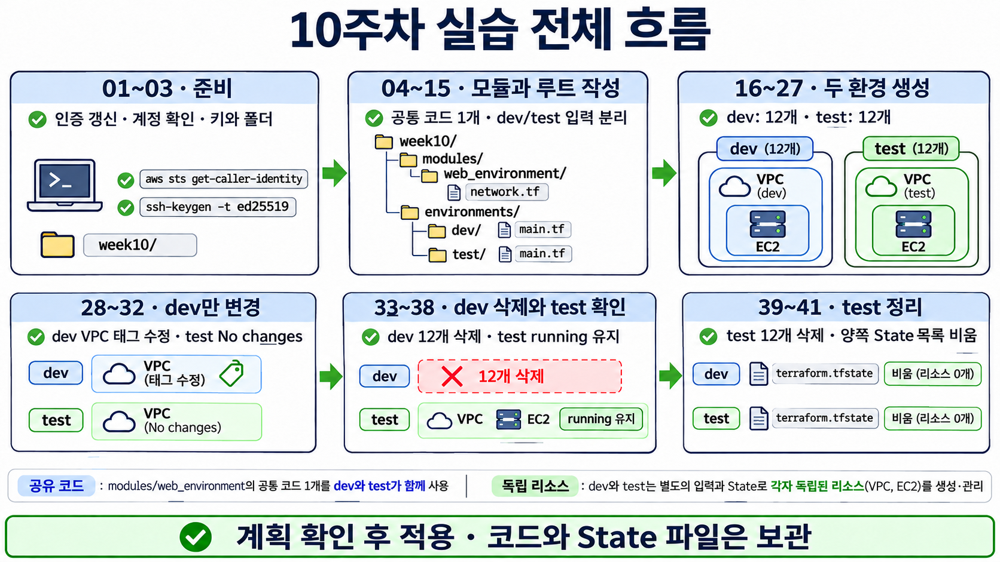
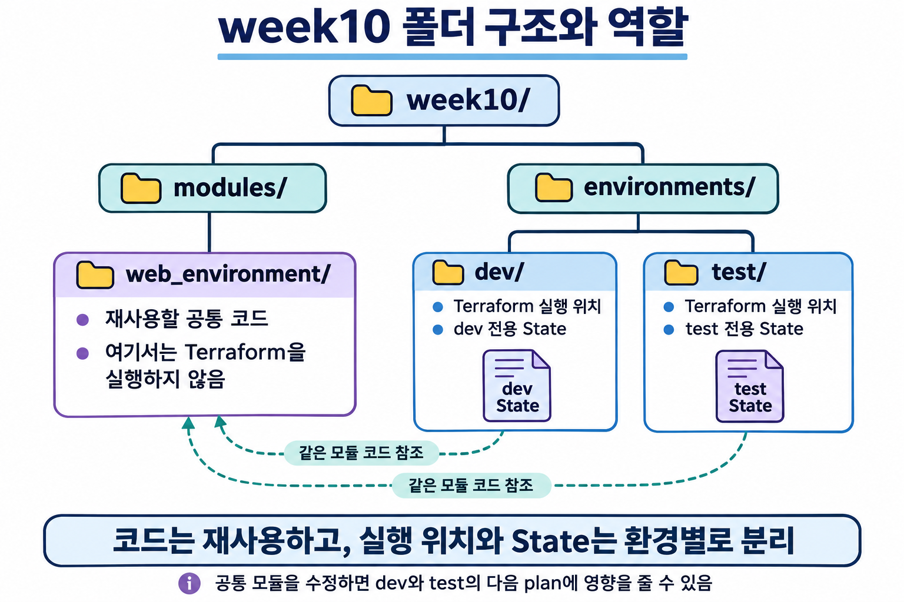
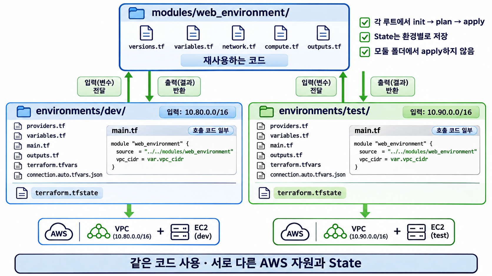
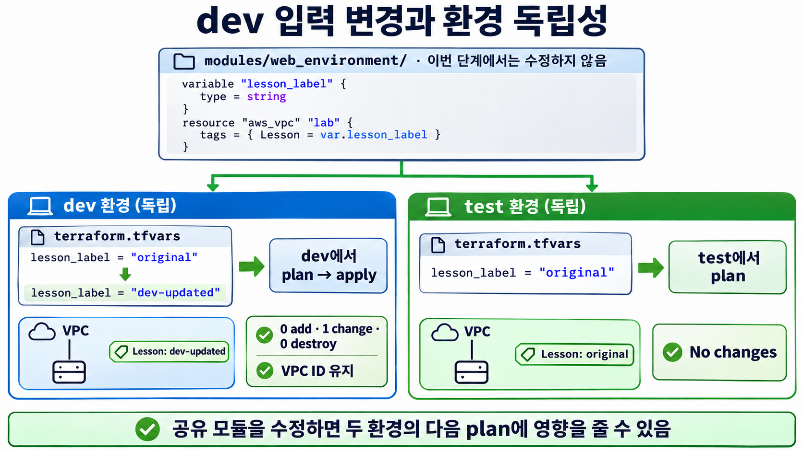
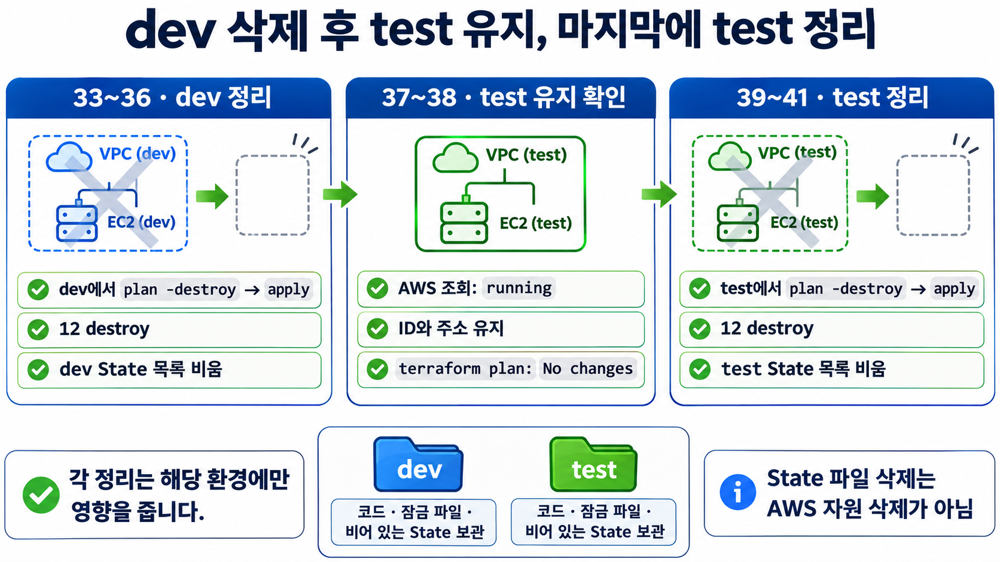

# Week 10 · 모듈 재사용과 dev/test 환경 분리 실습 가이드



[전체 실습 목록](../README.md) · [공통 준비](../common/README.md)

[← Week 09](../week09/README.md) · [Week 11 →](../week11/README.md)

9주차 **앞부분의 count 기반 네트워크·EC2 구성**을 작은 모듈 하나로 작성합니다. 9주차 마지막의 for_each 서브넷 구성을 가져오는 것이 아닙니다. 필요한 코드는 이 교안에 모두 제공하므로 9주차 파일을 직접 복사하지 않아도 됩니다. dev와 test는 같은 모듈 코드를 사용하지만 서로 다른 루트 디렉터리와 State를 갖습니다.

## 학습 목표

재사용하는 모듈 코드와 각 환경이 관리하는 자원의 경계를 구분합니다. 모듈 입력·출력을 연결하고, **dev의 입력 변경·자원 삭제 후에도 test가 유지되는지 확인**합니다.

140분 배분: 이론·코드 읽기 55분 · 모듈과 환경 분리 실습 70분 · 정리와 결과 확인 15분. 시간은 수업 설계 기준이며 도구 설치는 사전에 완료합니다.

9주차 자원이 남아 있다면 해당 주차의 정리를 마치고 시작합니다. 이미 삭제된 경우 별도 삭제는 생략합니다. 코드는 보관하고, 이번에는 새로운 `week10` 폴더의 dev/test에서 각각 새 자원과 State를 만듭니다.

흐름: **준비 → 공통 모듈 작성 → dev 생성 → test 생성 → dev 태그 변경·test 변경 없음 확인 → dev 삭제·test 유지 확인 → test 정리**.

검증 안내: 2026-11-26 학교 Ubuntu와 실제 Learner Lab에서 01~41번의 생성·변경·환경 분리·삭제를 실행했습니다. 이후 추가한 Provider 버전 범위·선택 결과 확인 단계는 실제 Lab에서 재실행하지 않았습니다. 결과와 검증 범위는 [검증 리포트](../VERIFICATION.md)에 기록합니다. 그림은 예상 동작을 설명하며 각자의 계정에서도 단계별 결과를 직접 확인합니다.



`.tfvars` 파일만 바꿔 같은 폴더에서 실행하면 독립된 State가 생기지 않습니다. 이번에는 루트 디렉터리 자체를 분리합니다. 같은 모듈을 수정하면 두 환경의 다음 plan에 영향을 줄 수 있다는 점도 기억합니다.

## 실습 준비와 설정값

| 항목 | 설정값 |
| --- | --- |
| 실행 환경 | 학교 Ubuntu 24.04 · 일반 사용자 Bash |
| AWS 환경 | 본인의 AWS Academy Learner Lab |
| 리전 | 미국 동부(버지니아 북부) `us-east-1` |
| 수업 시간 | 140분 · 도구 설치는 사전에 완료 |
| 작성 기준 폴더 | `~/cloud-infra/week10` |
| dev 실행 폴더 | `~/cloud-infra/week10/environments/dev` |
| test 실행 폴더 | `~/cloud-infra/week10/environments/test` |
| 환경별 입력 | dev `10.80.0.0/16` · test `10.90.0.0/16` · 각각 EC2 1대 |
| State 저장 위치 | dev/test 실행 폴더에 각각 `terraform.tfstate` |

처음 시작하거나 학교 VM이 초기화된 학생은 [공통 준비](../common/README.md)를 처음부터 수행합니다. 같은 VM·계정의 설치와 설정이 유지된 학생은 Lab 시작·Ready 확인 후 [08. 임시 인증 저장](../common/README.md#08-임시-인증-저장)과 [09. 계정 확인](../common/README.md#09-계정-확인)부터 수행합니다. 설치 상태가 불확실하면 [07. 설치 확인](../common/README.md#07-설치-확인)에서 버전을 확인하고 누락된 준비를 보완합니다.

**모든 학생은 인증·계정 확인 후 아래 01번부터 진행합니다.** `InvalidClientTokenId` 또는 `ExpiredToken`이 나오면 공통 준비 08번에서 세 인증 값을 모두 갱신하고 09번을 다시 확인합니다. 환경을 불러오는 `source`만으로 만료된 인증이 갱신되지는 않습니다.

이전 주차 AWS 자원이 남아 있으면 해당 주차에서 정리하고 코드와 State는 보관합니다. 이미 삭제됐다면 별도 삭제는 생략합니다. 이번 `week10` 폴더에 실습 파일이나 자원이 있다면 기존 dev/test의 정리를 마친 뒤 시작합니다. **이전 주차 또는 다른 환경의 State를 복사하거나 삭제해서 시작하지 않습니다.**

**실행 위치는 별도 표시가 없는 한 학교 Ubuntu 일반 사용자입니다.** 아래 블록을 번호 순서대로 전체 복사합니다. EC2 안에 대화형으로 들어가서 다음 Terraform 명령을 실행하지 않도록 주의합니다.

## 실습 절차

### 01. (학교 Ubuntu · 일반 사용자) 환경 불러오기와 주차 폴더 준비

```bash
source "$HOME/.config/cloud-infra/env.sh"
aws sts get-caller-identity
mkdir -p "$HOME/cloud-infra/week10"
cd "$HOME/cloud-infra/week10"
pwd
```

**명령어 풀이**

- `source`로 도구 경로·전용 인증 파일·리전을 설정합니다.
- `Account`가 자신의 Learner Lab 콘솔 계정과 같은지 확인한 뒤 진행합니다.
- `week10`은 파일 작성의 기준 폴더입니다. Terraform 실행과 State 저장은 이후 `environments/dev`, `environments/test`에서 각각 수행합니다. `sudo terraform`은 사용하지 않습니다.

**확인할 결과**

현재 경로가 `/home/자신의계정/cloud-infra/week10`입니다.

### 02. (학교 Ubuntu · 일반 사용자) EC2 접속용 키 준비

```bash
mkdir -p "$HOME/.ssh"
chmod 700 "$HOME/.ssh"
if [ ! -f "$HOME/.ssh/cloud-infra-lab" ]; then
  ssh-keygen -t ed25519 -f "$HOME/.ssh/cloud-infra-lab" -N '' -C "$(id -un)-cloud-infra"
fi
chmod 600 "$HOME/.ssh/cloud-infra-lab"
ssh-keygen -lf "$HOME/.ssh/cloud-infra-lab.pub"
```

**명령어 풀이**

- 개인 키는 학교 VM 안에 보관합니다. `.pub` 공개 키만 AWS에 등록합니다.
- `-t ed25519`는 키 형식, `-f`는 저장 위치, `-N ''`는 이 수업용 키의 암호를 비워 두는 옵션입니다.
- `if`는 이미 있는 키를 덮어쓰지 않도록 합니다. 같은 키를 다음 주에도 재사용합니다.
- 마지막 명령은 공개 키의 지문을 보여 줍니다. 개인 키 내용을 화면에 출력하지 않습니다.

**확인할 결과**

키 지문이 표시됩니다. 이 개인 키는 Learner Lab 임시 API 키와 다른 용도입니다.

### 03. (학교 Ubuntu · 일반 사용자) 모듈·환경 디렉터리 만들기

```bash
mkdir -p modules/web_environment environments/dev environments/test
```

**명령어 풀이**

모듈 폴더에서는 apply하지 않습니다. 실제 실행은 각각의 environments/dev, environments/test에서 수행합니다.

**확인할 결과**

`modules/web_environment`, `environments/dev`, `environments/test` 폴더가 만들어집니다. 성공하면 별도 출력은 없습니다. 아직 AWS 자원이나 State는 생성하지 않았습니다.

### 04. (학교 Ubuntu · 일반 사용자) modules/web_environment/versions.tf 작성



04~15번은 `~/cloud-infra/week10`에서 순서대로 실행합니다. 파일 이름 순서로 실행되는 것이 아니라 **각 루트의 `.tf` 파일들을 하나의 구성으로 읽고 `module` 블록으로 공통 모듈을 호출**합니다.

| 위치·파일 | 역할 |
| --- | --- |
| `modules/web_environment/versions.tf` | 자식 모듈의 Provider 요구 사항 |
| 모듈의 `variables.tf` · `network.tf` · `compute.tf` · `outputs.tf` | 입력 선언 · 네트워크 · EC2 · 결과 출력 |
| 각 루트의 `providers.tf` · `variables.tf` | Terraform·Provider 버전과 리전 · 루트 입력 선언 |
| 각 루트의 `main.tf` · `outputs.tf` | 모듈 호출과 입력 전달 · 모듈 결과를 루트 출력으로 공개 |
| 각 루트의 `terraform.tfvars` · `connection.auto.tfvars.json` | 해당 환경의 실제 입력값 |
| 각 루트의 `terraform.tfstate` | Terraform이 기록하는 환경별 관리 자원 정보 · 직접 작성하지 않음 |

같은 모듈을 호출해도 모듈 폴더에 공용 State가 만들어지는 것은 아닙니다. `connection.auto.tfvars.json`도 dev/test 루트마다 작성해야 합니다.

```bash
cat > modules/web_environment/versions.tf <<'EOF'
terraform {
  required_providers {
    aws = {
      source  = "hashicorp/aws"
      version = ">= 6.71.0"
    }
  }
}
EOF
```

**명령어 풀이**

자식(child) 모듈이 자신의 Provider 요구사항을 선언합니다. 여기서는 `hashicorp/aws`의 최소 버전을 `6.71.0`으로 지정합니다. 리전·인증 같은 Provider 설정은 루트의 `provider` 블록을 상속하지만, Provider 요구사항은 각 모듈이 직접 선언합니다.

**확인할 결과**

성공하면 별도 출력이 없습니다. `cat modules/web_environment/versions.tf`로 작성한 내용을 읽을 수 있습니다. 코드 블록은 첫 `cat`부터 마지막 `EOF`까지 전체를 복사합니다.

### 05. (학교 Ubuntu · 일반 사용자) modules/web_environment/variables.tf 작성

```bash
cat > modules/web_environment/variables.tf <<'EOF'
variable "name" {
  type = string
}
variable "vpc_cidr" {
  type    = string
  default = "10.70.0.0/16"
}
variable "ssh_cidr" {
  type = string
}
variable "public_key_path" {
  type    = string
  default = "~/.ssh/cloud-infra-lab.pub"
}
variable "ami_id" {
  type    = string
  default = "ami-0d6dd9e8265d48906"
}
variable "lesson_label" {
  type    = string
  default = "original"
}

variable "server_count" {
  type    = number
  default = 1
  validation {
    condition     = contains([1, 2], var.server_count)
    error_message = "server_count 는 1 또는 2여야 합니다."
  }
}

variable "enable_http" {
  type    = bool
  default = false
}
EOF
```

**명령어 풀이**

모듈의 입력 인터페이스입니다. 서버 수·이름·CIDR·접속 허용 주소를 루트에서 전달합니다. enable_http는 기본 false이며 다음 주 웹 서버 수업에서만 켭니다.

**확인할 결과**

성공하면 별도 출력이 없습니다. `cat modules/web_environment/variables.tf`로 작성한 내용을 읽을 수 있습니다. 코드 블록은 첫 `cat`부터 마지막 `EOF`까지 전체를 복사합니다.

### 06. (학교 Ubuntu · 일반 사용자) modules/web_environment/network.tf 작성

```bash
cat > modules/web_environment/network.tf <<'EOF'
resource "aws_vpc" "lab" {
  cidr_block           = var.vpc_cidr
  enable_dns_hostnames = true
  tags = {
    Name   = var.name
    Lesson = var.lesson_label
  }
}

resource "aws_subnet" "public" {
  count                   = 2
  vpc_id                  = aws_vpc.lab.id
  cidr_block              = cidrsubnet(var.vpc_cidr, 8, count.index)
  availability_zone       = ["us-east-1a", "us-east-1b"][count.index]
  map_public_ip_on_launch = true
  tags = { Name = "${var.name}-public-${count.index + 1}" }
}

resource "aws_internet_gateway" "lab" {
  vpc_id = aws_vpc.lab.id
  tags   = { Name = var.name }
}

resource "aws_route_table" "public" {
  vpc_id = aws_vpc.lab.id
  route {
    cidr_block = "0.0.0.0/0"
    gateway_id = aws_internet_gateway.lab.id
  }
  tags = { Name = "${var.name}-public" }
}

resource "aws_route_table_association" "public" {
  count          = 2
  subnet_id      = aws_subnet.public[count.index].id
  route_table_id = aws_route_table.public.id
}

resource "aws_security_group" "web" {
  name_prefix = "${var.name}-"
  description = "Cloud infrastructure class"
  vpc_id      = aws_vpc.lab.id
  tags        = { Name = var.name }
}

resource "aws_vpc_security_group_ingress_rule" "ssh" {
  security_group_id = aws_security_group.web.id
  cidr_ipv4         = var.ssh_cidr
  from_port         = 22
  to_port           = 22
  ip_protocol       = "tcp"
}

resource "aws_vpc_security_group_egress_rule" "outbound" {
  security_group_id = aws_security_group.web.id
  cidr_ipv4         = "0.0.0.0/0"
  ip_protocol       = "-1"
}

resource "aws_vpc_security_group_ingress_rule" "http" {
  count             = var.enable_http ? 1 : 0
  security_group_id = aws_security_group.web.id
  cidr_ipv4         = var.ssh_cidr
  from_port         = 80
  to_port           = 80
  ip_protocol       = "tcp"
}
EOF
```

**명령어 풀이**

9주차 앞부분에서 사용한 count 기반 두 서브넷 네트워크를 모듈 코드로 작성합니다. HTTP 규칙은 조건식 `var.enable_http ? 1 : 0`에 따라 1개 또는 0개 생성합니다. 기본값 false에서는 HTTP 규칙을 만들지 않습니다.

**확인할 결과**

성공하면 별도 출력이 없습니다. `cat modules/web_environment/network.tf`로 작성한 내용을 읽을 수 있습니다. 코드 블록은 첫 `cat`부터 마지막 `EOF`까지 전체를 복사합니다.

### 07. (학교 Ubuntu · 일반 사용자) modules/web_environment/compute.tf 작성

```bash
cat > modules/web_environment/compute.tf <<'EOF'
resource "aws_key_pair" "lab" {
  key_name_prefix = "${var.name}-"
  public_key      = file(pathexpand(var.public_key_path))
}

resource "aws_instance" "web" {
  count                       = var.server_count
  ami                         = var.ami_id
  instance_type               = "t3.micro"
  subnet_id                   = aws_subnet.public[count.index].id
  vpc_security_group_ids      = [aws_security_group.web.id]
  key_name                    = aws_key_pair.lab.key_name
  iam_instance_profile        = "LabInstanceProfile"
  associate_public_ip_address = true

  root_block_device {
    volume_type           = "gp3"
    volume_size           = 8
    encrypted             = true
    delete_on_termination = true
  }
  metadata_options {
    http_tokens = "required"
  }
  tags = { Name = "${var.name}-web-${count.index + 1}" }
  depends_on = [aws_route_table_association.public]
}
EOF
```

**명령어 풀이**

서버 생성 코드는 9주차의 count 구조를 유지합니다. 공통 모듈 내부에 특정 환경의 이름이나 CIDR을 고정하지 않습니다.

**확인할 결과**

성공하면 별도 출력이 없습니다. `cat modules/web_environment/compute.tf`로 작성한 내용을 읽을 수 있습니다. 코드 블록은 첫 `cat`부터 마지막 `EOF`까지 전체를 복사합니다.

### 08. (학교 Ubuntu · 일반 사용자) modules/web_environment/outputs.tf 작성

```bash
cat > modules/web_environment/outputs.tf <<'EOF'
output "vpc_id" {
  value = aws_vpc.lab.id
}
output "instance_ids" {
  value = aws_instance.web[*].id
}
output "public_ips" {
  value = aws_instance.web[*].public_ip
}
output "subnet_ids" {
  value = aws_subnet.public[*].id
}
EOF
```

**명령어 풀이**

루트에서 사용할 결과만 모듈 출력으로 제공합니다. 루트는 module.web_environment.public_ips 같은 형태로 읽습니다.

**확인할 결과**

성공하면 별도 출력이 없습니다. `cat modules/web_environment/outputs.tf`로 작성한 내용을 읽을 수 있습니다. 코드 블록은 첫 `cat`부터 마지막 `EOF`까지 전체를 복사합니다.

### 09. (학교 Ubuntu · 일반 사용자) environments/dev/providers.tf 작성

```bash
cat > environments/dev/providers.tf <<'EOF'
terraform {
  required_version = "= 1.17.1"
  required_providers {
    aws = {
      source  = "hashicorp/aws"
      version = ">= 6.70.0, < 6.72.0"
    }
  }
}

provider "aws" {
  region = "us-east-1"
  default_tags {
    tags = {
      Course = "cloud-infra"
      Week   = "10"
    }
  }
}
EOF
```

**명령어 풀이**

루트(root) 모듈도 자신의 Provider 요구사항을 선언하고, 실제 Provider 리전과 공통 태그를 설정합니다. 최소 버전을 child와 다르게 두어 초기화 시 두 요구사항이 함께 적용되는지 관찰합니다.

| 선언 위치 | AWS Provider 요구사항 |
| --- | --- |
| root: `environments/dev/providers.tf` | `>= 6.70.0, < 6.72.0` |
| child: `modules/web_environment/versions.tf` | `>= 6.71.0` |
| 두 요구사항의 교집합 | `>= 6.71.0, < 6.72.0` |

**한 루트 구성에서는 모든 모듈의 요구사항을 만족하는 AWS Provider 버전 하나를 선택합니다.** root용과 child용 버전을 따로 설치하는 것이 아니며, root의 조건이 child의 조건을 덮어쓰지도 않습니다. 이 예시에서 `6.70.x`는 child의 요구사항 때문에, `6.72.0` 이상은 root의 상한 때문에 선택할 수 없습니다. 18번에서 선택 결과를 확인합니다. [모듈의 Provider 요구사항](https://developer.hashicorp.com/terraform/language/modules/develop/providers)

**확인할 결과**

성공하면 별도 출력이 없습니다. `cat environments/dev/providers.tf`로 작성한 내용을 읽을 수 있습니다. 코드 블록은 첫 `cat`부터 마지막 `EOF`까지 전체를 복사합니다.

### 10. (학교 Ubuntu · 일반 사용자) environments/dev/variables.tf 작성

```bash
cat > environments/dev/variables.tf <<'EOF'
variable "name" {
  type = string
}
variable "vpc_cidr" {
  type    = string
  default = "10.70.0.0/16"
}
variable "ssh_cidr" {
  type = string
}
variable "public_key_path" {
  type    = string
  default = "~/.ssh/cloud-infra-lab.pub"
}
variable "ami_id" {
  type    = string
  default = "ami-0d6dd9e8265d48906"
}
variable "lesson_label" {
  type    = string
  default = "original"
}

variable "server_count" {
  type    = number
  default = 1
  validation {
    condition     = contains([1, 2], var.server_count)
    error_message = "server_count 는 1 또는 2여야 합니다."
  }
}

variable "enable_http" {
  type    = bool
  default = false
}
EOF
```

**명령어 풀이**

루트도 외부에서 입력받을 변수를 선언해야 합니다. 루트 변수와 자식 모듈 변수는 자동 연결되지 않습니다.

**확인할 결과**

성공하면 별도 출력이 없습니다. `cat environments/dev/variables.tf`로 작성한 내용을 읽을 수 있습니다. 코드 블록은 첫 `cat`부터 마지막 `EOF`까지 전체를 복사합니다.

### 11. (학교 Ubuntu · 일반 사용자) environments/dev/main.tf 작성

```bash
cat > environments/dev/main.tf <<'EOF'
module "web_environment" {
  source          = "../../modules/web_environment"
  name            = var.name
  vpc_cidr        = var.vpc_cidr
  ssh_cidr        = var.ssh_cidr
  public_key_path = var.public_key_path
  ami_id          = var.ami_id
  lesson_label    = var.lesson_label
  server_count    = var.server_count
  enable_http     = var.enable_http
}
EOF
```

**명령어 풀이**

`source`는 이 루트 기준 상대 경로입니다. 오른쪽 var 값은 루트 입력이며, 왼쪽 인자는 자식 모듈에 전달할 입력 이름입니다.

**확인할 결과**

성공하면 별도 출력이 없습니다. `cat environments/dev/main.tf`로 작성한 내용을 읽을 수 있습니다. 코드 블록은 첫 `cat`부터 마지막 `EOF`까지 전체를 복사합니다.

### 12. (학교 Ubuntu · 일반 사용자) environments/dev/outputs.tf 작성

```bash
cat > environments/dev/outputs.tf <<'EOF'
output "vpc_id" {
  value = module.web_environment.vpc_id
}
output "instance_ids" {
  value = module.web_environment.instance_ids
}
output "public_ips" {
  value = module.web_environment.public_ips
}
output "subnet_ids" {
  value = module.web_environment.subnet_ids
}
EOF
```

**명령어 풀이**

자식 모듈 출력을 루트 출력으로 다시 내보내야 루트에서 terraform output으로 볼 수 있습니다.

**확인할 결과**

성공하면 별도 출력이 없습니다. `cat environments/dev/outputs.tf`로 작성한 내용을 읽을 수 있습니다. 코드 블록은 첫 `cat`부터 마지막 `EOF`까지 전체를 복사합니다.

### 13. (학교 Ubuntu · 일반 사용자) test 루트에 구성 코드만 복사

```bash
cp environments/dev/providers.tf environments/test/
cp environments/dev/variables.tf environments/test/
cp environments/dev/main.tf environments/test/
cp environments/dev/outputs.tf environments/test/
```

**명령어 풀이**

복사 대상을 네 개의 코드 파일로 한정합니다. `.terraform`, `terraform.tfstate`, 저장된 계획, 자격 증명을 다른 환경으로 복사하지 않습니다.

**확인할 결과**

test 폴더에 네 개의 `.tf` 코드 파일이 준비됩니다. 성공하면 별도 출력은 없습니다. test의 입력 파일은 15번과 23번에서 따로 작성합니다.

### 14. (학교 Ubuntu · 일반 사용자) dev 입력값 작성

```bash
cat > environments/dev/terraform.tfvars <<EOF
name         = "ci-$(id -un)-dev"
vpc_cidr     = "10.80.0.0/16"
lesson_label = "original"
server_count = 1
EOF
```

**명령어 풀이**

- `terraform.tfvars`는 변수에 넣을 값을 적는 파일입니다. 파일 이름이 이와 같으면 자동으로 읽습니다.
- 여기서는 따옴표 없는 `<<EOF`를 사용해 `$(id -un)`이 현재 계정 이름으로 치환되게 합니다.
- `.tf`의 변수 선언은 입력 형식을 정하고, `.tfvars`는 이번 실행의 값을 정합니다.

**확인할 결과**

`environments/dev/terraform.tfvars`에 dev 이름, `10.80.0.0/16`, 서버 수 1이 저장됩니다.

### 15. (학교 Ubuntu · 일반 사용자) test 입력값 작성

```bash
cat > environments/test/terraform.tfvars <<EOF
name         = "ci-$(id -un)-test"
vpc_cidr     = "10.90.0.0/16"
lesson_label = "original"
server_count = 1
EOF
```

**명령어 풀이**

- `terraform.tfvars`는 변수에 넣을 값을 적는 파일입니다. 파일 이름이 이와 같으면 자동으로 읽습니다.
- 여기서는 따옴표 없는 `<<EOF`를 사용해 `$(id -un)`이 현재 계정 이름으로 치환되게 합니다.
- `.tf`의 변수 선언은 입력 형식을 정하고, `.tfvars`는 이번 실행의 값을 정합니다.

**확인할 결과**

`environments/test/terraform.tfvars`에 test 이름, `10.90.0.0/16`, 서버 수 1이 저장됩니다.

### 16. (학교 Ubuntu · 일반 사용자) dev 루트로 이동

```bash
cd "$HOME/cloud-infra/week10/environments/dev"
pwd
```

**명령어 풀이**

이제 dev의 코드·입력·State만 대상으로 Terraform을 실행합니다.

**확인할 결과**

현재 경로가 `/home/자신의계정/cloud-infra/week10/environments/dev`입니다.

### 17. (학교 Ubuntu · 일반 사용자) 학교 VM의 접속 주소를 변수 파일로 저장

```bash
ci_source_ip=$(curl -fsS https://checkip.amazonaws.com)
python3 - "$ci_source_ip" <<'PY'
import ipaddress, json, sys
address = str(ipaddress.IPv4Address(sys.argv[1].strip()))
with open("connection.auto.tfvars.json", "w") as f:
    json.dump({"ssh_cidr": address + "/32"}, f, indent=2)
print("허용할 학교 VM 출구 주소:", address + "/32")
PY
```

**명령어 풀이**

- `$(...)`는 명령 결과를 셸 변수에 넣습니다. 여기서는 학교 VM에서 AWS로 나가는 공인 주소를 구합니다.
- Python은 IPv4 형식을 확인하고 Terraform이 자동으로 읽는 `.auto.tfvars.json` 파일을 만듭니다.
- `/32`는 해당 주소 하나만 뜻합니다. SSH를 전 세계에 열지 않습니다.
- 같은 학교 출구 주소를 공유하는 환경이면 다른 학교 사용자도 네트워크 접근은 가능하지만 로그인에는 자신의 개인 키가 필요합니다.

**확인할 결과**

자신의 실행 환경에서 조회한 IPv4/32가 나옵니다. 23번에서는 이 파일을 test로 복사하므로 같은 주소를 다시 조회하지 않습니다. IP가 바뀌면 dev에서 이 단계를 다시 실행하고 test에 다시 복사한 뒤 각 환경에서 plan/apply합니다.

### 18. (학교 Ubuntu · 일반 사용자) 초기화·형식 정리·문법 확인

```bash
terraform init
terraform fmt -recursive
terraform validate
```

**명령어 풀이**

- `init`은 Provider와 모듈을 준비하고 `.terraform.lock.hcl`에 Provider 선택을 기록합니다.
- `fmt`는 들여쓰기를 정리합니다. `validate`는 구성의 문법과 참조를 확인하지만 AWS 생성 권한까지 확인하지는 않습니다.

**확인할 결과**

`Success! The configuration is valid.`가 표시됩니다.

### Provider 요구사항과 선택 버전 확인

같은 dev 폴더에서 다음 명령을 하나씩 실행하고 결과를 확인합니다.

```bash
terraform providers
```

`Providers required by configuration` 아래에서 root와 `module.web_environment`의 요구사항을 확인합니다. 모듈 이름은 앞의 `module` 블록 이름을 따릅니다. 이 명령은 **요구사항**을 보여주므로 설치된 정확한 버전은 다음 명령으로 확인합니다.

```bash
terraform version
```

```bash
cat .terraform.lock.hcl
```

- `terraform version`의 `provider registry.terraform.io/hashicorp/aws v...`는 선택된 버전입니다.
- lock 파일의 AWS Provider 블록에서 `version`은 정확한 선택 버전, `constraints`는 초기화 때 반영된 버전 조건입니다.
- 선택된 버전이 `6.71.0` 이상이면서 `6.72.0` 미만인지 확인합니다. 예를 들어 `6.71.0`이 선택되었다면 root와 child의 요구사항을 모두 만족합니다. 정확한 패치 버전은 실행 시점과 기존 lock 파일에 따라 달라질 수 있습니다.
- 해당 Provider의 기존 선택이 없으면 범위를 만족하는 최신 버전을 선택합니다. 기존 lock 파일에 호환되는 선택이 있으면 일반 `terraform init`은 그 버전을 재사용합니다.

기존 선택을 무시하고 현재 조건 안에서 최신 버전을 다시 선택하려는 경우에만, **plan을 만들기 전에** `terraform init -upgrade`를 실행합니다. lock 파일을 직접 편집하거나 삭제할 필요는 없습니다. [Dependency lock 파일](https://developer.hashicorp.com/terraform/language/files/dependency-lock)

**관찰 질문:** root는 `6.70.0`을 허용하는데 왜 `6.70.x`는 선택되지 않나요? child는 상한이 없는데 왜 `6.72.0` 이상은 선택되지 않나요?

### 19. (학교 Ubuntu · 일반 사용자) 처음 생성할 자원의 계획 확인

```bash
terraform plan -out=create.tfplan
```

**명령어 풀이**

- `plan`은 코드·State·AWS의 현재 상태를 비교합니다. 이 단계는 자원을 생성·변경하지 않습니다.
- `+`는 생성, `~`는 제자리 수정, `-`는 삭제, `-/+`는 교체입니다.
- `-out`은 이 계획을 저장합니다. 예상과 다르면 다음 apply를 실행하지 않습니다.

**확인할 결과**

Plan: 12 to add, 0 to change, 0 to destroy.

### 20. (학교 Ubuntu · 일반 사용자) 검토한 계획 적용

```bash
terraform apply create.tfplan
```

**명령어 풀이**

- 저장된 계획을 적용합니다. 추가 `yes` 질문이 없으므로 **직전 계획을 검토한 뒤** 실행합니다.
- 실행 중에는 Ctrl+C로 중단하지 말고 완료를 기다립니다. 오류가 나면 State를 지우지 말고 원인을 해결한 뒤 새로 plan합니다.

**확인할 결과**

`Apply complete!`와 변경 수가 표시됩니다. 출력 주소와 ID는 계정·실행마다 다릅니다.

### 21. (학교 Ubuntu · 일반 사용자) dev 자원 ID 기록

```bash
terraform output -json > dev-before.json
terraform state list
```

**명령어 풀이**

자원 주소가 `module.web_environment.aws_...`로 시작하는지 확인합니다. 모듈은 별도의 AWS 서비스가 아니라 코드 구성 단위입니다.

**확인할 결과**

dev 폴더에 `dev-before.json`이 저장되고, `module.web_environment.`로 시작하는 관리 자원 주소 12개가 표시됩니다.

### 22. (학교 Ubuntu · 일반 사용자) test 루트로 이동

```bash
cd "$HOME/cloud-infra/week10/environments/test"
pwd
```

**명령어 풀이**

다른 디렉터리로 이동하면 다른 로컬 State를 사용합니다. 이후 plan/apply가 어느 환경인지 pwd로 다시 확인합니다.

**확인할 결과**

현재 경로가 `/home/자신의계정/cloud-infra/week10/environments/test`입니다.

### 23. (학교 Ubuntu · 일반 사용자) dev의 접속 주소 설정을 test로 복사

같은 학교 VM에서 이어서 실습하므로 공인 IP를 다시 조회하지 않고, 17번에서 만든 접속 주소 설정을 재사용합니다.

```bash
cp ../dev/connection.auto.tfvars.json .
cat connection.auto.tfvars.json
```

**명령어 풀이**

dev/test는 별도 루트이므로 각 폴더에 `connection.auto.tfvars.json`이 필요합니다. 여기서는 SSH 접속을 허용할 주소만 복사합니다. State나 `.terraform` 폴더를 복사하는 것이 아니므로 두 환경의 자원 관리는 계속 분리됩니다.

**확인할 결과**

dev와 같은 `ssh_cidr` 값이 표시됩니다. 학교 VM의 출구 IP가 바뀌었다면 dev에서 17번을 다시 실행하고, test에서 이 복사를 다시 수행한 뒤 각 환경에서 plan/apply합니다.

### 24. (학교 Ubuntu · 일반 사용자) 초기화·형식 정리·문법 확인

```bash
terraform init
terraform fmt -recursive
terraform validate
```

**명령어 풀이**

- `init`은 Provider와 모듈을 준비하고 `.terraform.lock.hcl`에 Provider 선택을 기록합니다.
- `fmt`는 들여쓰기를 정리합니다. `validate`는 구성의 문법과 참조를 확인하지만 AWS 생성 권한까지 확인하지는 않습니다.

**확인할 결과**

`Success! The configuration is valid.`가 표시됩니다.

### 25. (학교 Ubuntu · 일반 사용자) 처음 생성할 자원의 계획 확인

```bash
terraform plan -out=create.tfplan
```

**명령어 풀이**

- `plan`은 코드·State·AWS의 현재 상태를 비교합니다. 이 단계는 자원을 생성·변경하지 않습니다.
- `+`는 생성, `~`는 제자리 수정, `-`는 삭제, `-/+`는 교체입니다.
- `-out`은 이 계획을 저장합니다. 예상과 다르면 다음 apply를 실행하지 않습니다.

**확인할 결과**

Plan: 12 to add, 0 to change, 0 to destroy.

### 26. (학교 Ubuntu · 일반 사용자) 검토한 계획 적용

```bash
terraform apply create.tfplan
```

**명령어 풀이**

- 저장된 계획을 적용합니다. 추가 `yes` 질문이 없으므로 **직전 계획을 검토한 뒤** 실행합니다.
- 실행 중에는 Ctrl+C로 중단하지 말고 완료를 기다립니다. 오류가 나면 State를 지우지 말고 원인을 해결한 뒤 새로 plan합니다.

**확인할 결과**

`Apply complete!`와 변경 수가 표시됩니다. 출력 주소와 ID는 계정·실행마다 다릅니다.

### 27. (학교 Ubuntu · 일반 사용자) test ID 보관과 환경 차이 확인

```bash
terraform output -json > test-before.json
python3 - <<'PY'
import json
dev = json.load(open("../dev/dev-before.json"))
test = json.load(open("test-before.json"))
assert dev["vpc_id"]["value"] != test["vpc_id"]["value"]
assert dev["instance_ids"]["value"] != test["instance_ids"]["value"]
print("dev/test의 VPC와 EC2가 서로 다름")
PY
```

**명령어 풀이**

모듈 코드가 같아도 각 루트에서 별개의 AWS 자원을 생성했는지 ID로 비교합니다.

**확인할 결과**

`dev/test의 VPC와 EC2가 서로 다름`이 표시됩니다. 오류가 나면 다음 단계로 넘어가지 말고 두 폴더의 출력과 State를 확인합니다.

### 28. (학교 Ubuntu · 일반 사용자) dev의 태그 입력만 변경



28~32번에서는 공유 모듈을 수정하지 않고 dev의 입력값만 바꿉니다. 같은 코드의 재사용과 환경별 변경 범위를 구분합니다.

```bash
cd "$HOME/cloud-infra/week10/environments/dev"
pwd
sed -i 's/lesson_label = "original"/lesson_label = "dev-updated"/' terraform.tfvars
```

**명령어 풀이**

공유 모듈 코드가 아닌 dev 입력 파일을 바꿉니다. test 입력은 original 그대로입니다.

**확인할 결과**

현재 경로가 dev이고 `terraform.tfvars`의 `lesson_label`이 `dev-updated`로 바뀝니다. 아직 AWS 태그에는 적용되지 않았습니다.

### 29. (학교 Ubuntu · 일반 사용자) 변경 계획 확인

```bash
terraform plan -out=dev-tag.tfplan
```

**명령어 풀이**

- `plan`은 코드·State·AWS의 현재 상태를 비교합니다. 이 단계는 자원을 생성·변경하지 않습니다.
- `+`는 생성, `~`는 제자리 수정, `-`는 삭제, `-/+`는 교체입니다.
- `-out`은 이 계획을 저장합니다. 예상과 다르면 다음 apply를 실행하지 않습니다.

**확인할 결과**

0 to add, 1 to change, 0 to destroy. dev의 VPC 태그만 바뀝니다.

### 30. (학교 Ubuntu · 일반 사용자) 검토한 계획 적용

```bash
terraform apply dev-tag.tfplan
```

**명령어 풀이**

- 저장된 계획을 적용합니다. 추가 `yes` 질문이 없으므로 **직전 계획을 검토한 뒤** 실행합니다.
- 실행 중에는 Ctrl+C로 중단하지 말고 완료를 기다립니다. 오류가 나면 State를 지우지 말고 원인을 해결한 뒤 새로 plan합니다.

**확인할 결과**

`Apply complete!`와 변경 수가 표시됩니다. 출력 주소와 ID는 계정·실행마다 다릅니다.

### 31. (학교 Ubuntu · 일반 사용자) test로 돌아와 영향 확인

```bash
cd "$HOME/cloud-infra/week10/environments/test"
pwd
```

**명령어 풀이**

현재 디렉터리를 test로 바꾼 뒤 별도로 plan을 실행합니다.

**확인할 결과**

현재 경로가 `/home/자신의계정/cloud-infra/week10/environments/test`입니다.

### 32. (학교 Ubuntu · 일반 사용자) 다시 실행해 변경 없음 확인

```bash
terraform plan
```

**명령어 풀이**

- 같은 코드를 다시 실행해도 자원이 반복 생성되지 않는지 확인합니다.
- 외부 변경·인증 만료·잘못된 폴더 때문에 다른 결과가 나올 수 있으므로 실제 문구를 읽습니다.

**확인할 결과**

`No changes. Your infrastructure matches the configuration.`

## dev 자원 정리와 test 유지 확인



33~38번은 dev만 정리한 뒤 test가 유지되는지 확인합니다. 39~41번에서 test도 정리합니다. **각 환경의 현재 폴더와 삭제 계획을 확인한 뒤 적용합니다.**

### 33. (학교 Ubuntu · 일반 사용자) dev 정리 위치로 이동

```bash
cd "$HOME/cloud-infra/week10/environments/dev"
pwd
```

**명령어 풀이**

dev만 먼저 삭제하고 test가 유지되는지 실제로 조회합니다.

**확인할 결과**

현재 경로가 `/home/자신의계정/cloud-infra/week10/environments/dev`입니다. 다음 삭제 계획은 dev만 대상으로 합니다.

### dev 삭제 계획과 적용

이 단계는 현재 폴더의 State가 관리하는 자원을 삭제합니다. 다른 주차 폴더에서 실행하지 않습니다. `terraform destroy`는 삭제 계획과 확인을 한 명령으로 수행하는 명령입니다. 여기서는 삭제 대상을 파일로 저장해 읽은 뒤 적용하는 같은 목적의 두 단계 절차를 사용합니다.

### 34. (학교 Ubuntu · 일반 사용자) 삭제 대상 확인

```bash
terraform plan -destroy -out=cleanup.tfplan
```

**명령어 풀이**

- `plan`은 코드·State·AWS의 현재 상태를 비교합니다. 이 단계는 자원을 생성·변경하지 않습니다.
- `+`는 생성, `~`는 제자리 수정, `-`는 삭제, `-/+`는 교체입니다.
- `-out`은 이 계획을 저장합니다. 예상과 다르면 다음 apply를 실행하지 않습니다.

**확인할 결과**

Plan: 0 to add, 0 to change, 12 to destroy.

### 35. (학교 Ubuntu · 일반 사용자) 검토한 계획 적용

```bash
terraform apply cleanup.tfplan
```

**명령어 풀이**

- 저장된 계획을 적용합니다. 추가 `yes` 질문이 없으므로 **직전 계획을 검토한 뒤** 실행합니다.
- 실행 중에는 Ctrl+C로 중단하지 말고 완료를 기다립니다. 오류가 나면 State를 지우지 말고 원인을 해결한 뒤 새로 plan합니다.

**확인할 결과**

`Apply complete!`와 변경 수가 표시됩니다. 출력 주소와 ID는 계정·실행마다 다릅니다.

### 36. (학교 Ubuntu · 일반 사용자) 관리 자원이 남아 있지 않은지 확인

```bash
terraform state list
```

**명령어 풀이**

- 출력에 `aws_...` 또는 `module....aws_...`로 시작하는 관리 자원이 없어야 합니다.
- 코드·잠금 파일·비어 있는 State는 보관합니다. State를 지우는 것은 AWS 자원을 삭제하는 작업이 아닙니다.
- 구성 파일을 남겨 두었기 때문에 정리 후 일반 `terraform plan`을 실행하면 다시 생성할 계획이 나오는 것이 정상입니다.

**확인할 결과**

이번 구성에서는 아무 자원 주소도 출력되지 않습니다.

### 37. (학교 Ubuntu · 일반 사용자) dev 삭제 후 test가 살아 있는지 확인

```bash
cd "$HOME/cloud-infra/week10/environments/test"
pwd
ci_test_id=$(terraform output -json instance_ids | python3 -c 'import json,sys; print(json.load(sys.stdin)[0])')
aws ec2 describe-instances --instance-ids "$ci_test_id" --query 'Reservations[0].Instances[0].{ID:InstanceId,State:State.Name}'
terraform output -json > test-after.json
python3 - <<'PY'
import json
assert json.load(open("test-before.json")) == json.load(open("test-after.json"))
print("test 출력 ID와 주소 유지 확인")
PY
```

**명령어 풀이**

State의 ID 비교에 더해 AWS API로 test EC2가 실제 running인지 확인합니다. dev 삭제로 test를 삭제하면 안 됩니다.

**확인할 결과**

현재 경로는 test이고 AWS 조회에서 EC2의 `State`가 `running`입니다. 이어 `test 출력 ID와 주소 유지 확인`이 표시됩니다.

### 38. (학교 Ubuntu · 일반 사용자) 다시 실행해 변경 없음 확인

```bash
terraform plan
```

**명령어 풀이**

- 같은 코드를 다시 실행해도 자원이 반복 생성되지 않는지 확인합니다.
- 외부 변경·인증 만료·잘못된 폴더 때문에 다른 결과가 나올 수 있으므로 실제 문구를 읽습니다.

**확인할 결과**

`No changes. Your infrastructure matches the configuration.`

## test 자원 정리 — 제출 전에 수행

이 단계는 현재 폴더의 State가 관리하는 자원을 삭제합니다. 다른 주차 폴더에서 실행하지 않습니다. `terraform destroy`는 삭제 계획과 확인을 한 명령으로 수행하는 명령입니다. 여기서는 삭제 대상을 파일로 저장해 읽은 뒤 적용하는 같은 목적의 두 단계 절차를 사용합니다.

### 39. (학교 Ubuntu · 일반 사용자) 삭제 대상 확인

```bash
terraform plan -destroy -out=cleanup.tfplan
```

**명령어 풀이**

- `plan`은 코드·State·AWS의 현재 상태를 비교합니다. 이 단계는 자원을 생성·변경하지 않습니다.
- `+`는 생성, `~`는 제자리 수정, `-`는 삭제, `-/+`는 교체입니다.
- `-out`은 이 계획을 저장합니다. 예상과 다르면 다음 apply를 실행하지 않습니다.

**확인할 결과**

Plan: 0 to add, 0 to change, 12 to destroy.

### 40. (학교 Ubuntu · 일반 사용자) 검토한 계획 적용

```bash
terraform apply cleanup.tfplan
```

**명령어 풀이**

- 저장된 계획을 적용합니다. 추가 `yes` 질문이 없으므로 **직전 계획을 검토한 뒤** 실행합니다.
- 실행 중에는 Ctrl+C로 중단하지 말고 완료를 기다립니다. 오류가 나면 State를 지우지 말고 원인을 해결한 뒤 새로 plan합니다.

**확인할 결과**

`Apply complete!`와 변경 수가 표시됩니다. 출력 주소와 ID는 계정·실행마다 다릅니다.

### 41. (학교 Ubuntu · 일반 사용자) 관리 자원이 남아 있지 않은지 확인

```bash
terraform state list
```

**명령어 풀이**

- 출력에 `aws_...` 또는 `module....aws_...`로 시작하는 관리 자원이 없어야 합니다.
- 코드·잠금 파일·비어 있는 State는 보관합니다. State를 지우는 것은 AWS 자원을 삭제하는 작업이 아닙니다.
- 구성 파일을 남겨 두었기 때문에 정리 후 일반 `terraform plan`을 실행하면 다시 생성할 계획이 나오는 것이 정상입니다.

**확인할 결과**

이번 구성에서는 아무 자원 주소도 출력되지 않습니다.

## 제출 및 확인 질문

- 모듈 입력→내부 자원→모듈 출력→루트 출력 흐름을 예로 설명합니다.
- dev/test의 서로 다른 VPC·EC2 ID, dev 태그 변경 계획, test No changes를 제출합니다.
- dev 삭제 후 test running 조회와 마지막 두 환경 모두의 빈 State를 제출합니다.
- `.tfvars`만 두 개 만드는 것과 루트 디렉터리를 나누는 것의 차이를 설명합니다.

제출 화면에는 비밀번호·Access Key·Secret Key·Session Token·개인 키·State 원문을 포함하지 않습니다. `.tf` 코드와 본인이 정리한 결과를 제출합니다. 계정 ID·IP가 포함된 화면은 수업 제출 범위에서만 사용합니다.

## 막혔을 때

| 증상 | 해결 |
| --- | --- |
| `InvalidClientTokenId` / `ExpiredToken` | Lab Ready 확인 후 공통 준비 08번의 인증 세 값을 갱신하고 09번 계정 확인 |
| 실행 폴더가 헷갈림 | `pwd`로 dev/test 루트를 확인. week10 상위나 modules 폴더에서는 apply하지 않음 |
| `ssh_cidr` 입력을 요구함 | 현재 dev/test 루트에 `connection.auto.tfvars.json`이 있는지 확인하고 해당 환경의 주소 저장 단계 재실행 |
| Module not installed | 해당 dev/test 루트에서 terraform init 실행 |
| Unsupported argument | 루트에서 모듈에 전달한 이름이 modules/.../variables.tf 선언과 일치하는지 확인 |
| No outputs found | 모듈 출력뿐 아니라 루트 outputs.tf가 있는지, 그 루트에서 apply했는지 확인 |
| test 계획에 예상하지 않은 교체 | pwd와 test 입력 이름·CIDR을 확인. dev State를 복사하지 않았는지 확인 |
| 두 환경 모두 변경 계획 발생 | 공통 모듈을 바꿨는지 확인. 이번 실습은 dev의 tfvars 태그만 수정 |

공통 인증·설치 오류는 [공통 준비의 문제 해결](../common/README.md#막혔을-때)을 확인합니다. 실제 검증 범위와 남은 제한은 [검증 리포트](../VERIFICATION.md)에 기록합니다.

---

[← Week 09](../week09/README.md) · [Week 11 →](../week11/README.md)
